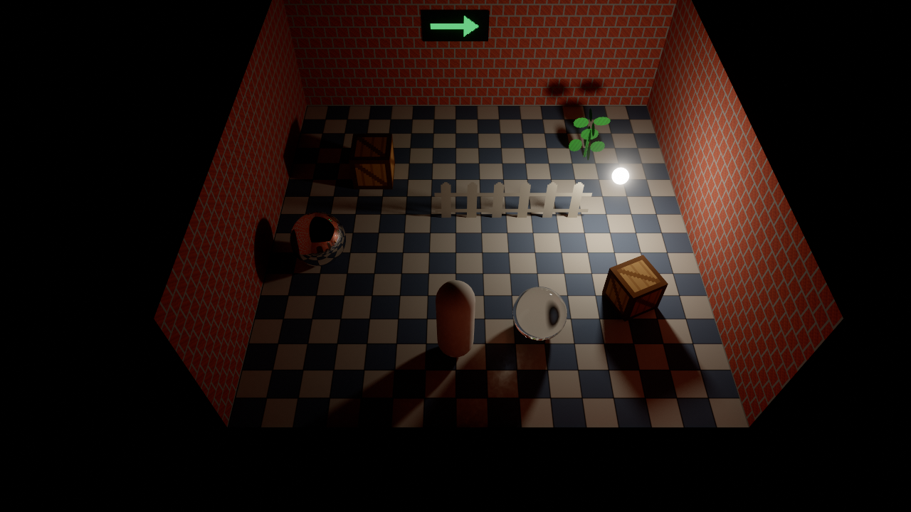
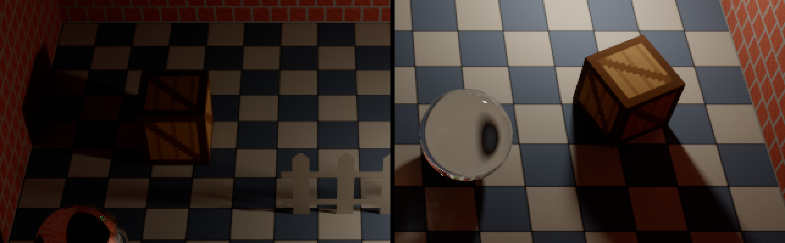

# Stage 25: textures

State: built. Gate met at rest; in motion the anti-aliasing pass of part 3 softens texture detail (section 6). Plan: [stage-25-textures.md](stage-25-textures.md).

`textured_720p`, 300 frames at rest: floor and wall textures from the room file, pixel art with the nearest filter (walls, crates), textures with holes and their shadows (fence, plant), an emissive texture (sign), a mirror ball and a glass ball.

## 1. What was built

- **Texture asset** (`maki_assets::Texture`, store `Textures`): RGBA, 8 bits. An image file that two materials, two models, or a room and a model name is loaded one time. After a room change the loader removes each texture that no mesh uses.
- **glTF**: base color texture, emissive texture, alpha mode, texture coordinate set 0, the filter of the sampler. Images in the file and image files next to it.
- **Texture coordinates on generated meshes.** Room box, cube, cuboid: meters. Sphere, capsule: one time around.
- **Room files**: `floor` and `walls` of the room, `texture` in a `look`: path, `scale`, `filter` (`Linear`, `Nearest`).
- **GPU**: images with mip levels, the format `Rgba8Srgb`, `Gpu::upload_image`, samplers that read mip levels, BLAS geometry without the opaque flag, TLAS instances that a culling ray does not cull.
- **Trace pass**: texture coordinates and texture slots in the mesh data, mip level from a ray cone, alpha test in the ray query loop, emissive textures. Three forms of the shader (section 4).
- **Test content by code**: `tools/gen_textured.py` (three PNG files and a model with five images in the file). Scenarios `textured_720p`, `textured_1080p`, `textured_walk_720p`.
- Setting `texture_bias` in `[render]`, with a slider in the Debug panel.

What the trace pass reads, and its size:

| Data | Before | Now |
|---|---|---|
| `MeshEntry`, for each mesh | 48 bytes | 64 bytes: + address of the texture coordinates (8), slot of the color texture (4), slot of the emissive texture (4). Two free floats of the old entry hold the texture coordinates per meter and the alpha cutoff |
| Normals, for each triangle corner | 4 bytes | 4 bytes |
| Texture coordinates, for each triangle corner | - | 8 bytes (two `f32`), only for a mesh that has a texture |

A slot is the bindless index of the image (16 bits) and that of the sampler (16 bits).

Texture coordinates are not packed. A 16-bit float has steps of 1/256 between 4 and 8: with coordinates in meters, a quarter of a texel for a texture of 64 pixels in a meter, and two texels for an atlas of 4096 pixels. 12 bytes more for each triangle of a textured mesh is the price.

Mip level: a ray cone (Akenine-Moller et al., 2021). A camera ray is as wide as one pixel of the picture at the full path length (also behind a mirror); the footprint on the surface is that width over the cosine of the angle. The mesh entry has the texture coordinates per meter (the median of the triangles, computed at the upload), and the level is `log2(footprint x coordinates per meter x texture size)`. Why: no screen derivatives in a compute shader, no triangle positions in the shader, one float for each mesh. After a diffuse bounce or a rough reflection the cone opens by 0.2 m for each meter: a coarse level. With a render scale below 1 and anti-aliasing on, the pixel is that of the picture, not of the traced image.

## 2. Numbers

Checks: `cargo build`, `cargo test --workspace` (93 tests, 88 before), `cargo clippy --workspace --all-targets`, `cargo fmt --check`: clean. Debug build with the validation layer: the textured room with the moving light (200 frames), with the walk script and `MAKI_RENDER_SELFTEST=1` (150 frames), a loop between a textured and a plain room (420 frames, 16 room loads), and the trip script (900 frames): no validation error, no warning.

**Old scenarios**, `python tools/bench.py compare s24 s25`, median in ms:

| Scenario | `gpu_trace` s24 | s25 | `gpu_total` s24 | s25 |
|---|---|---|---|---|
| `test_1080p` | 2.123 | 2.117 | 5.188 | 5.046 |
| `heavy_mixed_lights8_1080p` | 7.958 | 7.957 | 10.094 | 10.090 |
| `walk_720p` | 1.151 | 1.151 | 2.750 | 2.753 |
| `materials_720p` | 0.854 | 0.854 | 2.410 | 2.415 |

All 23 old scenarios: `gpu_trace` within 0.3 % (one at +2.1 % with `gpu_total` -0.1 %). Pictures (`bench.py same`): 20 byte-equal; 3 differ in at most 4673 pixels by at most 0.00012, as two runs of one binary do.

**Cost of the texture code**, `gpu_trace` of `test_1080p` (a scene with no texture) with each form of the shader forced:

| Shader | ms | Against stage 24 |
|---|---|---|
| No texture code (what the scene runs) | 2.114 | -0.4 % |
| Texture code | 2.163 | +1.9 % |
| Texture code and the alpha test in the ray query loop | 2.237 | +5.4 % |
| The same, with the opaque ray flag switched at run time | 2.262 | +6.5 % |

**New scenarios** (run `s25`), median in ms:

| Scenario | `gpu_trace` | `gpu_total` |
|---|---|---|
| `textured_720p` | 1.087 | 2.630 |
| `textured_1080p` | 2.174 | 5.176 |
| `textured_walk_720p` | 1.158 | 2.708 |

For comparison, room A with no texture: `test_720p` 1.057 and 2.620, `test_1080p` 2.117 and 5.046.

**Sharpness** (`bench.py quality`, 1280 x 720, 1 sample for each pixel and frame). "Full texture": the reference with `texture_bias = -16` (mip level 0 everywhere) and 65536 samples, which the anti-aliasing jitter makes a true mean of the texture over each pixel.

| Run | Reference | relmse | Sharpness |
|---|---|---|---|
| Rest, 64 frames, level with no bias | full texture | 0.00113 | 0.664 |
| Rest, 64 frames, bias -0.5 (now built in) | full texture | 0.00055 | 0.901 |
| Rest, 64 frames, bias -1.0 | full texture | 0.00054 | 0.905 |
| Rest, 64 frames | own (the same levels) | 0.00053 | 0.906 |
| Rest, 64 frames, denoiser off | own | 0.00064 | 0.908 |
| `test_720p` (no texture), rest | own | 0.00029 | 0.940 |
| Walk, frame 180 (last frame of motion) | own | 0.00176 | 0.734 |
| Walk, frame 180, denoiser off | own | 0.00181 | 0.735 |
| Walk, frame 180, anti-aliasing off | own | 0.00194 | 1.521 (stairs) |
| `walk_720p` (no texture), frame 180 | own | 0.00287 | 0.938 |
| Rest, traced at 640 x 360 | full texture | 0.00137 | 0.593 |
| The same with one level more (the level of the traced pixel) | full texture | 0.00333 | 0.381 |

- The denoiser does not blur texture detail: 0.906 with it, 0.908 without.
- The level for "one texel for each pixel" was too soft (0.66). The shader now takes half a level less (`LEVEL_BIAS`): 0.90, the level of the picture with no texture. One level less gives no more.
- In motion the picture is softer (0.73). The cause is the anti-aliasing pass, not the textures or the denoiser (section 6).

Parts of the picture, three times larger: nearest textures stay crisp (crates, bricks), the joints of the floor tiles are one texel wide, the fence and its shadow have the shape of the texture.

**GPU memory** (the loop of two rooms, 8 times there and back): 304.81 MB after each load, of the textured room and of the plain room. The first two turns differ by 768 bytes; from the third turn on each load gives 304 806 912 bytes. 8 textures uploaded and 8 removed in each turn.

**Load time**: the first frame of the textured room has `room_load_ms` 27.7, that of room A 27.6.

## 3. Files

New:
- `crates/assets/src/texture.rs`: `Texture`, `TextureRef`, `Textures` (load one time, remove what no mesh uses).
- `crates/render/src/textures.rs`: `GpuTextures` (images, the two samplers, slots), the mip levels (mean of the light, not of the sRGB numbers).
- `crates/render/shaders/trace.glsl`: the path tracer (was `trace.comp`). `trace.comp`, `trace_textured.comp`, `trace_cutout.comp`: three lines each, with the defines.
- `tools/gen_textured.py`: test textures and model.

Changed:
- `crates/assets/src/mesh.rs`: texture coordinates, textures, alpha cutoff, `open_back`, `uvs_per_meter`; `planar_uv`; `Mesh::room_parts`. `model.rs`: the glTF loader reads textures.
- `crates/scene/src/room.rs`: `TextureDef`, `Filter`, `LookDef::texture`, `RoomDef::floor` and `walls`; the loader removes unused textures.
- `crates/gpu/src/resources.rs`, `lib.rs`, `accel.rs`: `Rgba8Srgb`, `ImageDesc::mip_levels`, `SamplerDesc::mipmaps`, `mip_level_count`, `upload_image`, `BlasGeometry::opaque`, `TlasInstance::two_sided`.
- `crates/render/src/meshes.rs`: the larger entry, the buffer of texture coordinates, `TextureUse`. `passes.rs`: three pipelines, the two new parts of `flags`. `settings.rs`, `lib.rs`: `texture_bias`. `shaders/scene.glsl`: `UvBuffer`, the texture functions.
- `crates/ui/src/render_panel.rs` (slider), `crates/gameplay/src/player.rs` (the player model can have textures), `tools/bench.py` (scenarios, `TEXTURED_ROOM`).
- `README.md` ("Textures", `texture_bias`), `OPEN_ITEMS.md`, `Cargo.toml` (`image`).

Pictures: `pictures/stage-25-textured.png`, `stage-25-detail.png`, `stage-25-motion.png`.

## 4. Deviations

- **Three forms of the trace shader, not one.** The prompt: only meshes with a mask material pay for the alpha test, opaque meshes stay on the fast path. Measured: the test code in the ray query loop costs 3.4 % of the trace pass for all rays, also when no mesh has holes and with the opaque ray flag set at run time (then 6.5 %); the texture lookup costs 1.9 % more, with one untaken branch for each hit. So `trace.glsl` is compiled three times (no texture code, `TEXTURES`, `TEXTURES` and `CUTOUT`), and a frame runs the smallest form that the meshes on the GPU need (`GpuMeshes::texture_use`). A scene with no texture keeps its numbers. In a scene with one cutout mesh, the alpha test runs only for that mesh (only its geometry has no opaque flag), but each ray runs the largest shader: +5.4 % of the trace pass.
- **`image` is a direct dependency of `assets`** (0.25.10, the version that `gltf` brings: no second copy), for the PNG and JPEG files that a room file names. A dev-dependency of `scene` too: its test writes image files.
- **The room box is two meshes only if it has a texture.** With no `floor` and no `walls` it is one mesh as before: the old rooms give the same pictures, byte for byte.
- **`texture_bias`** is a setting that the prompt does not ask for. It makes the reference with the full texture possible, and it is the control for "sharper or softer".
- **The texture is uploaded outside of the frame** (`Gpu::upload_image` waits for the GPU, as the BLAS build does), with mip levels made on the CPU. No copy command in the frame, no pass, no state between frames.
- **`BLEND` shows as `MASK` with the cutoff 0.5**, as the prompt permits.

Not done:
- Wrap modes of a glTF sampler: a texture always repeats.
- A room file cannot give a generated mesh an emissive texture or a texture with holes.
- No picture of a cutout card from behind. By the code: the camera does not cull it (only the room box is culled), the normal is turned to the viewer, so the card shows its texture mirrored and with the light of that side.

## 5. Decisions

- **`Textures` is one resource**: the asset store and the map from a source (file path, or model path and image number) to its handle. `load_gltf` gets it as a fourth argument.
- **Which textures a room change removes**: each one that no mesh of the mesh store uses (`Textures::remove_unused`). The player model is not a room asset; its textures stay because its meshes stay.
- **All textures are color (sRGB)**. `Texture::srgb` exists for data textures; none is read yet.
- **Two samplers**: linear and nearest, both repeat, both blend between mip levels. With `Nearest` a texel that shows large keeps its hard edges; a texture that shows small is blended (the nearest texel of a far surface is noise).
- **Texture coordinates in meters by projection** (`planar_uv`): the floor has (x, z), a wall is upright and not mirrored for a viewer in front of it. Wall pieces that touch continue the pattern. A cuboid starts at its corner, so an image as large as a side shows one time. `scale` multiplies the coordinates on the CPU: no cost in the shader.
- **Coordinates per meter are one number for each mesh** (the median of its triangles). A mesh whose triangles have very different densities gets a level that is wrong for some of them.
- **The alpha test reads mip level 0** for each ray. A coarse level would change how much of the card is surface with the distance, and so the size of a shadow.
- **Camera cull only for the room box**: `Mesh::open_back`, set by the room generators; each other TLAS instance has the flag against the cull. No test in the shader.
- **`LEVEL_BIAS = -0.5`** from the measurement in section 2.
- **`TextureUse` comes from the meshes on the GPU**, not from the room: a room change picks the shader with no other code.
- **The mesh table entry is written one time.** A texture must be loaded before its mesh is uploaded: true while loading is synchronous.

## 6. Uncertain

- **Motion.** In the last frame of the walk the textured picture has the sharpness 0.73 (0.90 at rest). The denoiser is not the cause (0.735 without it), and the raw frame has the detail (1.52 with the anti-aliasing off, with stairs). It is the history of the anti-aliasing pass, read between pixels in each frame: the open item "Anti-aliasing in motion" of part 3, which a scene with no texture shows less (0.94). Not fixed here: it is a change of the `taa` pass. `pictures/stage-25-motion.png` has the frame (top) and the reference (bottom): softer joints, the pixel art still reads.
- **Pixel art in motion was not looked at in real time**, only in that one frame and in the numbers. If it swims, the fix is in the same pass.
- **Half the render size**: 0.59 against the full texture (0.38 with the level of the traced pixel). The same open item.
- **Through the glass ball** the floor shows as one large tile: the ball stands on the floor and is a lens. The reference with the full texture shows the same.
- **No file from a modelling tool was loaded.** JPEG files, images of 16 bits, and textures of some thousand pixels were not tried.
- **A floor at a flat angle** gets the level of its long side (no anisotropic filter): softer than necessary. The top-down camera has no flat angle to the floor.
- **Machine noise** as in stage 24: bursts of the trace time some seconds after the start show in the maximum of each run, not in the medians.

## 7. What to watch for: results

| Check | Result |
|---|---|
| Blurred textures | No. Sharpness 0.906 with the denoiser and 0.908 without, against the same reference. The `albedo` guide has the texture (`surface.albedo` is the color times the texture, also behind a mirror and glass) |
| Shimmer | At rest the picture is a mean with no change. The level was too coarse by half a level, not too sharp: fixed (`LEVEL_BIAS`). With half the render size the pixel of the picture gives the level: 0.59 against 0.38. In motion: section 6 |
| Cutout cost on everything | Opaque meshes do not run the alpha test: only a cutout geometry has no opaque flag. But the test code in the loop costs 3.4 % for all rays, so a scene with no cutout runs a shader without it. `heavy_mixed_lights8_1080p`: `gpu_trace` 7.958 to 7.957 ms |
| Vertex data bloat | 16 bytes more for each mesh, 8 bytes for each triangle corner of a textured mesh, nothing for other meshes (section 1) |
| Pixel-art filtering | Crisp at rest (`stage-25-detail.png`). In motion: one frame looked at, not the running game (section 6) |
| Textures that stay loaded | No. 8 turns between a textured and a plain room: the same GPU memory after each load, 8 textures removed in each turn. Test: `a_room_takes_textures_from_its_file_and_the_next_room_removes_them` |
| Old room files | `room_a.ron`, `room_b.ron`, `room_c.ron` are not changed and load: `test_*`, `trip_720p`, and `materials_720p` give the pictures of stage 24, byte for byte |
