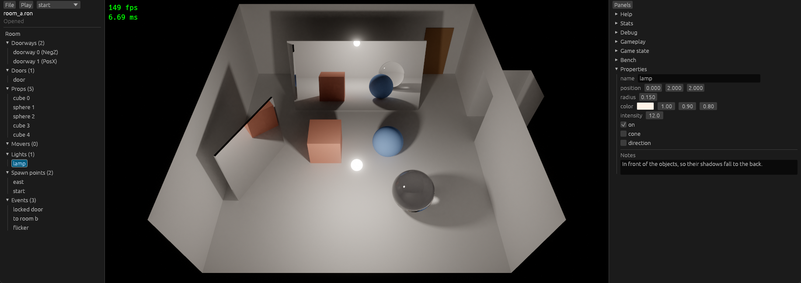

# Stage 26: editor shell

State: built. Gate met: a room is opened, a prop and a light are changed in the property panel, the file is saved, and the game without the editor feature loads it; play and stop restore the room and the game state, also after a Transfer. Plan: [stage-26-editor-shell.md](stage-26-editor-shell.md).



`maki-game --editor` (feature `editor`), room A open, the lamp selected: the outliner at the left, the picture of the editor camera, the panel column with "Properties" at the right. Picture size 1152 x 648.

## 1. What was built

- **Crate `editor`** (`maki-editor`), the last crate before the game. The game has it behind the cargo feature `editor` and starts in it with `--editor`.
- **Document**: the content of one room file: `RoomDef`, the events (`Vec<EventDef>`), the comments, the path, a dirty flag. The panels write the document and a command queue, never the world.
- **World from the document**, in each frame while the room is edited. A change of a light (not its name) or of the pose of a prop with a generated mesh is patched into the entities (`maki_scene::patch_room`): no load, no mesh build, the picture keeps its history. Each other change loads the room again from the text of the document (`RoomTarget::text`).
- **Writer of room files** (`ron_text.rs`): the one-line text of the `ron` crate, with line breaks put in: one item on one line if it fits in 110 characters, else one field on each line. Fields at their default are not written (`skip_serializing_if` in `scene` and `events`). The `//` comments of a file are kept (section 5).
- **Panels**: at the left "File" (new, open, save, save as, quit), "Play"/"Stop" with the spawn point, and the outliner; in the column "Properties" (numbers, vectors, colors, enums, file paths, texture fields, notes; events are shown only). A menu "Panels" in the first row of the column has one checkbox for each panel.
- **Layout**: the picture keeps its size; the window has a margin at each side (`WindowMargin { left, right }`), and the picture starts at the right of the left panel.
- **Input**: `platform` has the pointer (`Pointer`: position, motion), mouse buttons as keys, a key table with the full keyboard, and input modes: a binding belongs to a mode, and only the bindings of the current mode start actions. The editor has its own mode and binding table; the help panel shows the table of the current mode.
- **Editor camera**: turn (right button), move (middle button), zoom (wheel), view from the top (T), view of the game camera (G). The marker `ActiveCamera` selects the camera of the picture.
- **Play and stop**: play gives the keys, the clock, the player, and the picture to the game and loads the room from the document; stop puts back the game state of before, sets back the event runner, the message, and the fade, and loads the document again.
- `maki-game --editor-resave ROOM`: writes a room file again in the form of the editor, with no window.

Edit and play, what each part does:

| Part | While the room is edited | While the game is played |
|---|---|---|
| Clock | `Time::paused`: no fixed step, so no event, no mover, no walk | Runs |
| Keys | `InputMode("editor")`: the keys of the game start nothing | `InputMode::GAME`: the keys of the editor start nothing |
| Player | Its `MeshInstance` is taken off (component `Parked`) | Shows |
| Picture | Editor camera has `ActiveCamera` | Game camera has it |
| Quit request (Esc, close button) | Asks if the room has changes, then ends the app | Stops the game (`QuitHold`) |

## 2. Numbers

Checks: `cargo build`, `cargo test --workspace` (102 tests, 93 before; 4 more with `-p maki-game --features editor`: 1 new), `cargo clippy --workspace --all-targets` with and without `--features maki-game/editor`, `cargo fmt --check`: clean.

Debug build with the validation layer, no error and no warning of the layer in each run:
- The game, `--bench-frames 900 --bench-script trip`: the same events as before (to room b, switch, lamp is dead, to room a, flicker, locked door).
- The editor, by mouse and keys in the real window (section 7): open, select, drag values, save, play, the way to room B and back, stop, new room, the dialog, close.
- A scene with no mesh instance (TLAS with no instance): black picture with the lamp, `render scene ... instances=0`.

**Benchmarks**, `python tools/bench.py compare s25 s26`, median in ms. All 26 scenarios: `gpu_trace` within 0.5 %, `gpu_total` within 0.5 % but for `test_1080p`.

| Scenario | `gpu_trace` s25 | s26 | `gpu_total` s25 | s26 |
|---|---|---|---|---|
| `test_720p` | 1.057 | 1.056 | 2.620 | 2.620 |
| `test_1080p` | 2.117 | 2.125 | 5.046 | 5.191 |
| `test_1080p_bounces2` (the same config) | 2.125 | 2.123 | 5.187 | 5.186 |
| `heavy_mixed_lights8_1080p` | 7.957 | 7.939 | 10.090 | 10.078 |
| `walk_720p` | 1.151 | 1.148 | 2.753 | 2.747 |
| `trip_720p` | 0.682 | 0.681 | 2.627 | 2.628 |
| `materials_720p` | 0.854 | 0.852 | 2.415 | 2.412 |
| `textured_720p` | 1.087 | 1.085 | 2.630 | 2.620 |
| `textured_walk_720p` | 1.158 | 1.157 | 2.708 | 2.707 |

`test_1080p` has two values on this machine (5.05 and 5.19 ms) with one binary: stage 24 found the same, and `test_1080p_bounces2` has the same config. Its passes did not change (`gpu_trace` +0.4 %).

Pictures, `python tools/bench.py same SCENARIO s25 s26`: 24 of 26 byte-equal, with `walk_720p`, `trip_720p`, and the three textured scenarios. `test_2160p`: 55 pixels differ by at most 0.00012. `heavy_lights8_1080p`: 4936 pixels by at most 0.00006. The means are equal; two runs of one binary differ this much (stage 25 found the same in 3 scenarios).

**Release binary**:

| Build | Size in bytes | `maki_editor` in the file | `editor_orbit` |
|---|---|---|---|
| Stage 25 (`fb418ba`, built from an exported copy) | 13 488 128 | - | - |
| Stage 26 without the feature | 13 596 160 | 0 | 0 |
| Stage 26 with `--features editor` | 14 553 088 | 10 | 2 |

Without the feature, `--editor` is `unknown option "--editor"`. The build without the feature is 108 032 bytes (0.8 %) larger than stage 25: the code of this stage in the engine crates (the key table, the pointer, the input modes, `RoomItem`, `patch_room`, the left panel and the menu of `ui`), which each build has.

Line count of `game/src`: 407 (341 at stages 24 and 25). `main.rs` 170: the feature, the two options, the editor module, and one test of the room files (27 lines).

## 3. Files

New:
- `crates/editor/Cargo.toml`.
- `crates/editor/src/lib.rs`: `EditorModule`, the resource `Editor`, the commands, play and stop, the world from the document, the command line options, `resave`.
- `document.rs`: `Document`, `Item`.
- `ron_text.rs`: `pretty` (line breaks), `Notes` and `read_notes` (comments).
- `camera.rs`: `EditorCamera`, its actions and bindings.
- `panels.rs`: the left panel, "Properties", the dialog. `widgets.rs`: one widget function for each kind of value.
- `tests.rs`: the editor with no window.

Changed:
- `crates/core/src/time.rs`, `app.rs`: `Time::paused`.
- `crates/platform/src/input.rs`: the key table (71 inputs, was 23), `InputMode`, `add_mode_bindings`, `Pointer`. `window.rs`: mouse buttons and pointer events, `QuitHold`, `WindowMargin::left`; the close button is a quit request. `lib.rs`: a test.
- `crates/scene/src/room.rs`: `RoomItem` on each entity of a room item, `RoomTarget::text`, `check_room`, `patch_room`, `LightDef::light`, `skip_serializing_if` on each field with a default, the field order of `RoomDef`. `lib.rs`: `ActiveCamera`.
- `crates/events/src/model.rs`: `skip_serializing_if`.
- `crates/gameplay/src/camera.rs`: `FollowCamera`; the camera of the game has `ActiveCamera`. `player.rs`, `light_control.rs`: the move direction is that of the active camera.
- `crates/gpu/src/lib.rs`: `copy_into` (was `copy_to_corner`), with an offset. `crates/render/src/lib.rs`, `passes.rs`: `ExtractedFrame::picture_left`. `camera.rs`: the active camera.
- `crates/ui/src/lib.rs`: the left panel (`add_left_panel`), the menu, `Panels::unfold`. `help.rs`: the bindings of the current mode.
- `game/src/main.rs`, `game/Cargo.toml`: the feature and the options. `game/src/shake.rs`: the shake moves the follow camera.
- `README.md` ("Editor", panels, crates), `CLAUDE.md` (crate list, rule 1), `OPEN_ITEMS.md`, `Cargo.toml`.

Pictures: `pictures/stage-26-editor.png`, `stage-26-change.png` (the lamp at 2.0 and the view turned), `stage-26-dialog.png` (the view from the top and the question).

## 4. Deviations

- **The three room files of the game are not changed.** The stage keeps comments as comments (section 5), so no file had to be converted. A save in the editor gives a file its form (section 7, "Comment loss").
- **A new room is not empty**: it has one lamp and the spawn point `start`. With no light the picture of a new room is black.
- **`Time::paused` in `core`.** The prompt does not name it. It is the one switch that stops events, movers, and the player at one time with no edit of a module (rule 5).
- **Quit goes through a request.** The close button of the window sets `QuitRequested` (before: it ended the event loop), and `QuitHold` lets a module answer it. Without that, "an unsaved change asks before close" is not possible.
- **No stop key of its own.** Stop is the button, or the quit request (Esc in this game): a second action on Esc would stop the game and, one frame later, ask to quit the editor.
- **The stage list (`StagesModule`) is not added with `--editor`**: it loads a room with no word to the editor. "Open" of the editor is in its place.
- **Line width 110**, not 100: the room files of the game have lines of 105 characters.

Not done:
- No widget changes an event (stage 28); no add, delete, or duplicate of an item (stage 27).
- No key for "Save": a binding has no modifier key (`OPEN_ITEMS.md`, "Key chords").
- The cost of a full reload was not measured in the editor. From the benchmark: 2 ms on the CPU for a room with generated meshes (`trip_720p`, `room_load`), and one wait for the GPU for each mesh (`OPEN_ITEMS.md`, "BLAS build stops the game"). A drag of a value that is not patched (the size of the room, a mesh, a color of a prop) does that in each frame, and the picture starts again in each frame: it follows, with noise.

## 5. Decisions

- **Feature of the game binary, not a separate binary.** The editor needs the module list of the game: its event commands (`ShakeCamera`) to read the room files, and its gameplay modules to play. A second binary would repeat the list.
- **Place of the crate**: `... -> ui -> devtools -> editor -> game`. It depends on `ui` and below, not on `devtools`.
- **Layout: the margin scheme, with a margin at each side.** The picture keeps the size of the config, so the editor shows the pixels that the game shows, the render path has no second size, and the benchmark numbers cannot move. Cost: the window is 1960 pixels wide for a picture of 1280 (`OPEN_ITEMS.md`, "Size of the editor window").
- **Comments: kept, with a writer of our own.** Not a `notes` field. `read_notes` takes each comment from the text with the list item that it is before or in; the document holds them beside the room (`Notes`: list name and index); the writer puts them back before their item. Why: no type of `scene`, `assets`, or `events` gets a field for the editor (`Doorway` is a `Copy` type of `assets`), the game does not read notes, and the files stay as a person wrote them. The scanner was necessary for either way (a converter must find the comments). The property panel shows and changes the notes of the selected item.
- **Notes of spawn points**: as for each other item, by the place of the spawn point in the file (the map is in name order). `Document::rename_spawn` moves them with the name.
- **A comment that is not at an item** (before a field, after the last item of a list) becomes a note of the room, at the top of the file. Nothing is dropped; the place can change one time.
- **Dirty is a flag** that each change sets and a save clears, as the prompt says. A value that is changed and changed back leaves the flag set.
- **Play is from the text of the document**, also with changes that are not saved ("Do not save" on play). A Transfer away and back then loads the file: the question tells that the room has changes.
- **Play from**: the spawn point of the list at "Play" (default: the start spawn of the game, else the first one); a room with no spawn point: the point that the editor camera looks at.
- **Input modes in `platform`**: `Binding::mode` and the resource `InputMode`. This is what keeps the move keys from the player in the editor and T and G from the view in the game, with no edit of a gameplay module.
- **Mouse buttons are keys** (`Key::MouseLeft`): a drag is an action that is held, and `Pointer::delta`. `InputCapture::pointer` covers them: no new rule.
- **`RoomItem`** (prop, light, door, mover, with the index) on each entity of the room: the patch finds its entities with it, and stage 27 will find the item of a picked entity.
- **`FollowCamera`** in `gameplay`: `follow_player` and the shake wrote each `Camera`. They now write the camera of the game only.
- **A text field changes the room when it loses the focus**, not with each key: half of a file name is not a file.
- **The panel menu is the first row of the column**, in the game too. The column now shows also with no open panel (the menu must stay); `Panels::close_all` (a screenshot) hides it.

## 6. Uncertain

- **Window size.** On this display (1920 pixels) the editor window with the default picture is wider than the screen, and Windows puts a part of the column off the screen. The check and the pictures used 1152 x 648.
- **Display scale other than 100 %** was not tried (open item).
- **A drag of a value that needs a reload** was not looked at for smoothness, only the patched ones (light, pose).
- **The shake of the game** (`CameraShake`) keeps its time over a stop: it runs out on the game camera, which the editor does not show. A module with other play state would show it (`OPEN_ITEMS.md`, "Play state of a module").
- **Events with `Transfer` in the editor directory**: play of a new room that is not saved has no file; a Transfer back to it fails with the log line of the loader.
- **Pan and turn speeds** are constants that felt right in three drags by script, not in real use.
- **Machine noise** as in stages 24 and 25.

## 7. What to watch for: results

| Check | Result |
|---|---|
| Editing the world, not the document | The panels get `&mut Editor` only (`panels.rs`, `with_editor`); `Document::save` writes `Document::text`. No code reads a component back. Test: after a patch, `CurrentRoom::def` is the room of the document |
| Lost events | `room_a.ron` saved with no change has its 3 events (`events:` is written from `Document::events`). Test in `game`: the three room files are read, written, and read again: the same room, the same 7 events (with `ShakeCamera`), the same notes |
| Comment loss | `--editor-resave` of copies of the three files: 14, 10, and 8 comment lines before and after, each before the same item. Diff of `room_a.ron` below |
| Full reload on every slider drag | A drag of the intensity and of the position of the lamp in the window: the log has one `room loaded` line for the session, and the picture follows with no noise (`stage-26-change.png`). Test: `CurrentRoom::loads` does not change for a light and a pose, and is one more for a new mesh |
| Play that leaks | In the window: play from `east`, walk to room B, press the switch (`power_off`, lamp off), walk back to room A (the flicker event runs), stop. After the stop: room A as edited, lamp steady, no flag in the Game state panel, no running event. Test: an Autorun event sets a flag, turns the lamp off, and transfers to another room; after the stop the game state, the room, and the lamp are those of before |
| Feature leakage | Section 2: no editor text in the release binary without the feature; the benchmark numbers and pictures are those of stage 25; the binary is 0.8 % larger by engine code |
| Game input in the editor | With a room open: the move keys do nothing (the player does not show and no fixed step runs). "tg" typed into the name field of the lamp: the name changes, the view does not; T with no field in focus gives the view from the top. Test in `platform`: a key starts only the actions of the current mode |

`room_a.ron`, saved with no change (`git diff`, without the 6 lines that are only moved):

```diff
     spawns: {
-        "start": (-0.5, 0.0, 2.6),
         "east": (3.2, 0.0, -1.0),
+        "start": (-0.5, 0.0, 2.6),
     },
...
             name: "to room b",
             area: (center: (4.9, -1.0), size: (0.8, 1.2)),
-            pages: [
-                (trigger: Touch, commands: [FadeOut(0.4), Transfer("room_b.ron", "west"), FadeIn(0.4)]),
-            ],
+            pages: [(trigger: Touch, commands: [FadeOut(0.4), Transfer("room_b.ron", "west"), FadeIn(0.4)])],
...
                     commands: [
-                        LightIntensity("lamp", 3.0), Wait(0.06),
-                        LightIntensity("lamp", 12.0), Wait(0.9),
-                        LightIntensity("lamp", 6.0), Wait(0.05),
-                        LightIntensity("lamp", 12.0), Wait(1.7),
+                        LightIntensity("lamp", 3.0),
+                        Wait(0.06),
+                        LightIntensity("lamp", 12.0),
+                        Wait(0.9),
+                        LightIntensity("lamp", 6.0),
+                        Wait(0.05),
+                        LightIntensity("lamp", 12.0),
+                        Wait(1.7),
                     ],
```

Three changes: the spawn points in name order (a map), one list that now fits on one line, one list with one command on each line. Each other line, with the 14 comment lines, is the same.

Open items: "Two cameras", "List of panels", "TLAS with no instance", and "Keys of an action" are removed (their checks passed). New: "Key chords", "Size of the editor window", "Play state of a module", "Names that events use", "Place of a comment in a room file".
