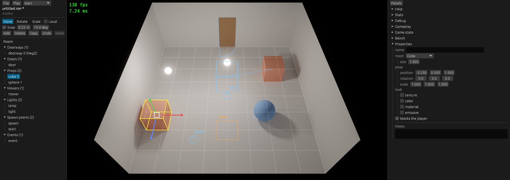

# Stage 27: viewport editing

State: built. Gate met: a room was built from the new-room template with the mouse alone (props, lights, a doorway with its door, a mover, a spawn point, an event area), saved, and played. Plan: [stage-27-viewport-editing.md](stage-27-viewport-editing.md).

A new room after 7 "Add" and 7 drags: the selected cube with its box and the move gizmo, the grid of the floor, the swing of the door, the two poses of the mover (the box and the line), two spawn points, an event area.

## 1. What was built

- **Pick** (`view.rs`): a click in the picture selects the item that the ray of the pixel hits first. On the CPU, against the triangles of each mesh instance of the room, with the rule of the camera rays (no hit on the back side of the room box). Lights, spawn points, and event areas have pick shapes: a sphere of at least 0.2 m, a sphere on the floor, the rectangle of the area. Shift adds to the selection. The outliner and the picture have one selection (`Editor::selection`, a list; the last item is the one of the property panel and of the gizmo).
- **Gizmo** (`gizmo.rs`), our own: move (three axes, and a square that moves over the floor), rotate (three rings), scale (three axes of the item), in the axes of the room or of the item. A drag makes the room again from the room at its start and the full motion, in each frame.
- **Snap**: position to `grid_step` (0.25 m), rotation to `angle_step` (15 degrees), scale to 0.05; on by default, off while Ctrl is held. The new settings table `[editor]` has the three values; the left panel shows and changes them.
- **Add, delete, duplicate, rename** (`ops.rs`): ten kinds in the "Add" menu, with a list of the model files at the room file. A delete of a doorway removes its door and gives the doors of the doorways behind it their new index. Names are unique in their group, and a rename changes the built-in commands of the events that use the name.
- **Undo and redo**: `History`, a copy of the content of the document (room, events, comments) for each step.
- **Marks** (`overlay.rs`): floor grid, event areas and spawn points with names, hinge and swing of each door, second pose of each mover, box of each selected mesh, radius and cone of a selected light, opening of a selected doorway, the gizmo. Lines and text of the egui painter.
- Engine: `maki_ui::add_overlay` (shapes on the picture, under the windows), `CommandRegistry::command` (a command from a value of its enum), `patch_room` also for the poses of a mover.

## 2. Numbers

Checks: `cargo build`, `cargo test --workspace` (114 tests, 102 before; 1 more with `-p maki-game --features editor`), `cargo clippy --workspace --all-targets` with and without `--features maki-game/editor`, `cargo fmt --check`: clean.

Debug build with the validation layer, no error and no warning of the layer: the game with `--bench-frames 900 --bench-script trip` (the 8 events of before), and the editor in the real window for the checks of section 7 (three sessions).

**Benchmarks**, `python tools/bench.py compare s26 s27`: `gpu_trace` and `gpu_total` of all 26 scenarios within 0.8 %. Over 0.5 %: `test_2160p` trace +0.8 %, `heavy_mixed_1080p` trace +0.7 % and total +0.6 %, `heavy_1080p` total +0.6 %. This stage has no change in `gpu` or `render`.

| Scenario | `gpu_trace` s26 | s27 | `gpu_total` s26 | s27 |
|---|---|---|---|---|
| `test_720p` | 1.056 | 1.056 | 2.620 | 2.621 |
| `heavy_mixed_lights8_1080p` | 7.939 | 7.949 | 10.078 | 10.078 |
| `trip_720p` | 0.681 | 0.682 | 2.628 | 2.630 |
| `textured_walk_720p` | 1.157 | 1.157 | 2.707 | 2.707 |

Pictures (`bench.py same`, s26 against s27): 22 of 26 byte-equal. `test_1080p` 61 pixels, `test_1080p_bounces2` 54, `heavy_lights8_1080p` 3607, `textured_1080p` 27, each by at most 0.00006, with equal means: the difference of two runs of one binary.

**Release binary**: 13 595 136 bytes without the feature (13 596 160 at stage 26), 14 930 432 with it. No `maki_editor` text in the build without the feature.

Line count of `game/src`: 407, not changed. `crates/editor/src`: 4724 lines (2155 at stage 26), with 20 tests (8 at stage 26).

## 3. Files

New, in `crates/editor/src`:
- `view.rs`: `View` (pixel of a point, ray of a pixel), `Ray` (triangle, sphere, floor plane, nearest place on a line), `pick`, `mesh_boxes`.
- `gizmo.rs`: `Tool`, `Handle`, `Gizmo` (where the handles are, which one is under a pixel), `Drag`.
- `ops.rs`: `Kind`, `Document::add`, `delete`, `duplicate`, `unique_name`, `renamed`, `rename_in_events`, `History`, `spawn_users`.
- `overlay.rs`: the marks.

Changed:
- `crates/editor/src/lib.rs`: the selection as a list, `EditorSettings`, 13 bindings, the commands `Add`, `Delete`, `Duplicate`, `Undo`, `Redo`, `Editor::viewport` (click and drag), `Editor::keys`. `document.rs`: `Place`, `Document::place`, `pose_of`, `parse`. `panels.rs`: the tool rows, the "Add" menu, shift in the outliner, names, the name and area of an event. `widgets.rs`: `drag`; the color button works on a copy. `tests.rs`: 2 tests.
- `crates/events/src/command.rs`: `CommandRegistry::command`. `model.rs`: its test.
- `crates/scene/src/room.rs`: `patch_room` for movers.
- `crates/ui/src/lib.rs`: `add_overlay`.
- `README.md` ("Editor", `[editor]`), `OPEN_ITEMS.md`.

Pictures: `pictures/stage-27-layout.png`, `stage-27-gizmo.png` (room A, the first cube turned by 45 degrees, the scale tool), `stage-27-rename.png` (room B, the spawn point `west` with a new name and the warning).

## 4. Deviations

- **A bug of stage 26 is fixed here.** The color button of egui wrote the color back in each frame, with the rounding of its color space: a look at a light changed its color in the document (`0.9` to `0.90000004`), with no dirty mark. The undo history showed it as a step that no one made. Now the button works on a copy, and a number widget does not clamp a value that it only shows (`widgets::drag`). Test: each kind of item is shown for three frames; the text of the document and the history do not change.
- **No handle for the direction of a cone light, and none for the size of an event area.** The property panel has the numbers; the marks show the cone and the rectangle.
- **A rotation or a scale of more than one item** turns and scales each item at its place. A move takes all of them.
- **Ctrl+Z, Ctrl+Y, Ctrl+D, Ctrl+S** are two actions each (the letter and `MODIFIER` on Ctrl): a binding has no modifier (`OPEN_ITEMS.md`, "Key chords").
- **"Copy"** is the text of the duplicate button: the row of five buttons must fit in the left panel.
- **A doorway is added at the end of the list**, so an add moves no index; a door goes into the first doorway that has none. No command puts a doorway before another one.

Not done:
- No model file was added in the editor: the game has none, and the generated ones of the benchmark are not at the room files. The code path (the list of files, `Kind::Model`) is not run by a test.
- The editor settings are not written to the config file (`OPEN_ITEMS.md`, "Config values at run time").

## 5. Decisions

- **Pick on the CPU, not an id image.** A click is one ray against some ten thousand triangles (room A: 11 000), less than a millisecond, with no BVH. An id for each pixel is a new output of the trace pass in three shader forms, a read-back one frame later, and a cost that a build without the editor must not have. The CPU ray uses the same meshes, the same transforms, and the same cull rule as the camera rays, so it selects what the picture shows.
- **What a click through glass or on a mirror selects: the glass or the mirror itself.** They are surfaces of the picture. To select a thing that shows in a mirror, click the thing, or its row in the outliner.
- **The walls and the floor select nothing**, but they hide: a click on a wall does not reach an event area in the passage behind it.
- **Gizmo: our own.** No crate was added. `transform-gizmo-egui` could not be checked against egui 0.36 without the network, and it brings its own camera math and interaction; ours is 300 lines on `Ray::along`, which the pick needs too, and draws with the same painter as the other marks.
- **A drag starts from the room of its start in each frame.** No error adds up over frames, and a snap is a snap of the result: along an axis of the room the place goes onto the grid, also for an item that was off it; along an axis of the item the way snaps.
- **Positions are rounded to 0.1 mm and angles to 0.01 degrees** after a drag: no `2.4999998` in a room file.
- **Undo: a copy of the content for each step**, at most 200. No command objects. In each frame the document is compared with the last step; a difference is a new step, but not while a mouse button is down, a widget has the keyboard, or a handle is dragged. So a drag of a handle, a drag of a number, and a typed text are one step each, and no code path can forget to record a change. Dirty stays a flag: an undo back to the saved room leaves it set.
- **The history is of the document only**: selection, tool, and view are not steps. An undo keeps the selection where its items still exist.
- **Names**: unique among lights; among doors and movers together (`OpenDoor` finds the two); among events; a spawn point is a key of a map. A taken name gets a number (`lamp_2`), with a line in the status. A prop needs no name.
- **Rename updates the events of the room** for the built-in commands (`LightOn`, `LightOff`, `LightIntensity`, `OpenDoor`, `CloseDoor`, also in the lists of an `If`). A command of another module is not known to the editor and is not changed.
- **Rename of a spawn point: the other room files are not changed.** The editor reads the room files of its directory, and the status line names each file with a `Transfer` to the old name (`room_a.ron: a Transfer still names west`). A `Transfer` of the room to itself is changed. Why not change the files: the editor has one document open, and a write to a file that is not open has no undo.
- **A delete of a doorway removes its door**, with a line in the status, and the indices of the other doors follow.
- **Marks with the egui painter, not a line pass.** They are drawn by the UI pass, after the tone curve: not in the path tracer, the denoiser, or the anti-aliasing, and no new graphics state. Cost: no depth test (`OPEN_ITEMS.md`, "Marks behind objects").
- **`add_overlay` in `ui`**: an area under the windows, clipped to the picture, that gets no input. The handles are hit-tested by the editor from the pointer, not by egui.
- **New items**: on the floor at the point that the view looks at, on the grid. A light at 0.6 m below the ceiling.

## 6. Uncertain

- **The place of a click is the place of the pointer in the frame that sees the press.** My input script pressed and moved in the same millisecond: the click then landed 17 pixels off and took another handle (two drags of the first scripted run). With a wait of 100 ms after the press all drags were exact. A hand does not do this; a tool does (`OPEN_ITEMS.md`).
- **Feel**: the handle sizes (90 pixels), the reach (9 pixels), and the ring pick were used by script only.
- **Rings seen from the side** are a line on the screen; the screen angle then turns fast. Not looked at.
- **Model files** in the editor: not run (section 4).
- **A drag of a mover or a prop is patched**, a drag of a door or a doorway value loads the room in each frame (stage 26): not looked at for smoothness.
- **Machine noise** as before.

## 7. What to watch for: results

| Check | Result |
|---|---|
| Picking the wrong thing | Room A, by clicks in the window (log line `click in the picture`). The glass ball: the ball (`Prop(2)`), not the floor behind it. The cube and the sphere in the back mirror: the mirror (`Prop(3)`). The left mirror: `Prop(4)`. The first cube, seen through the near wall (the camera is outside of the room): the cube. The door: `Door(0)`. The lamp: `Light(0)`. The spawn mark: `Spawn("start")`. The area of "locked door": `Event(0)`. The area of "to room b", which is in the passage behind the east wall: nothing (the wall hides it, as in the picture). The floor: nothing. Room B, the mirror ball: the ball (`Prop(2)`). The edge of a pixel: the ray goes through the place of the pointer in the pixel, not through a jittered sample; not tried at an edge |
| Undo granularity | A drag of the floor square over 2.4 s and 35 pointer steps (`stage-27-layout.png`), then one click on "Undo": the cube is at its start. The status had "13 steps back": 7 adds and 6 drags before it, one step each. Test: 30 frames of a drag are one step |
| Overlays in the denoiser | No. The marks are egui shapes in the UI pass (`add_overlay`). In play they are not drawn. The benchmark pictures are those of stage 26 |
| Name references | Test `a_rename_changes_the_events_and_a_name_stays_unique`: a new name of a light goes into `LightOff` and into `LightOn` in an `If`; a new name of a door into `OpenDoor`, and the other door keeps `CloseDoor`. The spawn point `west` of room B, renamed in the window: the status line is "room_a.ron: a Transfer still names `west`" (`stage-27-rename.png`); `room_a.ron` is not changed |
| Doorway indices | Test `a_removed_doorway_takes_its_door_and_the_other_doors_keep_their_doorway`: of two doorways with a door each, the first is removed: one door is left, that of the other doorway, with the index 0 and its comment. A new doorway is the last one; a new door goes into it |
| ID output in the game | No id image: the pick is on the CPU, in the editor crate. `gpu_trace` is that of stage 26 (section 2) |

The gate, step by step in the window, with the mouse only: "File", "New room"; "Add" cube, sphere, light, doorway, door, mover, spawn point, event area, each moved with the floor square of the gizmo (but the doorway and the door: property panel); "File", "Save" (`untitled.ron`); "Play": the game shows the room with the player at `start`; the quit key stops. The saved file had the 2 props, the door in its doorway, the mover with its two poses, 2 lights, 2 spawn points, and the event with its area. The size of the room (walls) is three numbers of the property panel, changed by a drag in stage 26.

Open items: "Movers of a room file" is removed (test: a mover that the editor adds goes to its pose `b` when an event runs `OpenDoor`, and the event goes on). "Place of a comment in a room file" is removed (test: a copy and a delete keep the comment of an item with the item). Updated: "Room file props from files", "Events with the same name", "Graphics pipeline state" (no line pass), "Key chords", "Names that events use". New: "Place of the pointer at a click", "What the gizmo does not change", "Marks behind objects".
