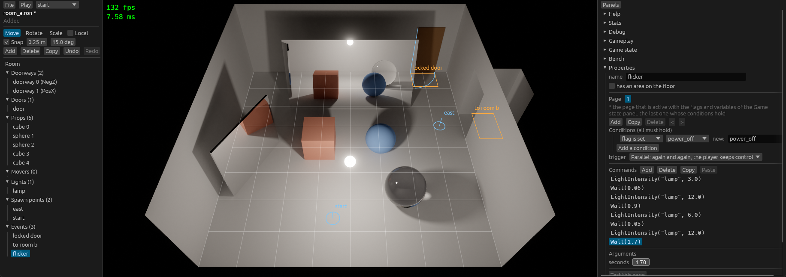

# Stage 28: event editor

State: built. Gate: met for the events, not done for the rest of the rooms. The 7 events of the part 2 vignette (and the game's `mirror ball`) were deleted in the editor and made again by hand in the editor, with no RON file open; the saved room files are the files of the game but for 4 comment lines, and the trip plays the same in the game without the editor (same script log, byte-equal picture). The boxes, props, lights, doorways, and spawn points of rooms A and B were kept, not made again (section 4). Plan: [stage-28-event-editor.md](stage-28-event-editor.md).

Room A in the editor: the event `flicker`, made again by hand. No area, the condition "flag is set `power_off`" (picked: the flag is used in room B), the trigger `Parallel`, 8 command rows, and the arguments of the selected `Wait`.

## 1. What was built

- **Event panel** (`event_panel.rs`), the property panel of a selected event: name; area with a checkbox for "no area"; pages as tabs with add, copy, delete, and order; a star at the page that is active with the game state of the "Game state" panel; conditions as rows (kind, name, value); the trigger as a choice of four, with the note on `Autorun`; commands as rows with the lists of an `If` under it (`Else`, `End`), with add, delete, copy, paste, and move by drag.
- **Arguments**: widgets for the 14 built-in commands. A light, a door, or a mover is picked from the room; a flag or a variable from the names that the events of all room files in the directory use, or typed as a new one; `Transfer` picks a room file, then a spawn point of that file. A command of another module: widgets that the module gives (`add_argument_editor`), else a text field with the command as a room file has it, read with each key (`ShakeCamera(0.6, 0.06)`).
- **Checks** (`events.rs`, `problems`): a light, door, or mover that the room does not have; a `Transfer` to a room file or spawn point that does not exist; two events with one name. Red on the row, `(!)` at the event in the outliner, a count in the status line at a save.
- **"Where used"**, a panel: each flag and variable of the game with each place that reads or writes it (room file, event, page, condition or command).
- **Test run**: "Test this page" plays the room, starts the page whatever its trigger and conditions are, in step mode; "Step" runs one command; the command that waits shows under the file name.
- Engine (`events`): `EventRunner::set_step_mode`, `step_command`, `start_event`; `CommandRegistry::parse_command` (one command from its text).

## 2. Numbers

Checks: `cargo build`, `cargo test --workspace` (120 tests, 114 before; 1 more with `-p maki-game --features editor`), `cargo clippy --workspace --all-targets` with and without `--features maki-game/editor`, `cargo fmt --check`: clean.

Debug build with the validation layer, no error and no warning of the layer: the game with `--bench-frames 900 --bench-script trip` (8 event starts, as before), and the editor in the window for the rebuild and the checks of section 7 (three sessions).

**The rebuilt rooms in the game** (release build, no editor feature):

| Check | Result |
|---|---|
| Saved files against the files of the game (in the form of the editor) | Equal but for the comments of 3 events that were deleted and made again: 1 line in `room_a.ron`, 4 in `room_b.ron` |
| Debug log of the trip script, 900 frames | The same 33 lines (script legs with the player position, event starts, messages), but for the path of the room files |
| `trip_720p` of `bench.py` with the rebuilt files in place of the files of the game, `bench.py same trip_720p s27 rebuilt` | `ok`: the picture is byte-equal |

**Benchmarks**, `python tools/bench.py compare s27 s28`: `gpu_trace` and `gpu_total` of all 26 scenarios within 0.8 %. Pictures: 22 of 26 byte-equal, with `trip_720p` and `walk_720p`; `test_1080p` 7 pixels, `test_1080p_bounces2` 54, `heavy_lights8_1080p` 3560, `textured_1080p` 27, each by at most 0.00006 with equal means (the noise of two runs).

**Release binary**: 13 595 648 bytes without the feature (13 595 136 at stage 27), 15 134 720 with it. No `maki_editor` text in the build without the feature.

## 3. Files

New:
- `crates/editor/src/events.rs`: `Row`, `rows`, `list`, `edit_list`, `move_command`; `Names` and `Use`; `OtherRoom`, `other_rooms`; `Problem`, `problems`.
- `crates/editor/src/event_panel.rs`: the panel, `EventUi`, `ArgumentEditors`, `add_argument_editor`.

Changed:
- `crates/editor/src/lib.rs`: `Command::Test`, `Editor::others` and `problems`, the count of problems at a save. `panels.rs`: the event panel in "Properties", "Where used", "Step" and "Run", `(!)` in the outliner. `tests.rs`: 2 tests.
- `crates/events/src/interpreter.rs`: the step mode and `start_event`. `command.rs`: `parse_command`. `tests.rs`: 2 tests.
- `README.md` (the event panel), `OPEN_ITEMS.md`.

Pictures: `pictures/stage-28-flicker.png`, `stage-28-event.png` (page 2 of `locked door`), `stage-28-check.png` (the door was deleted: the row of `OpenDoor` is red), `stage-28-step.png` (a test run waits before `Message`), `stage-28-where-used.png` (`power_off`: 4 reads, 1 write, in two room files).

## 4. Deviations

- **The rooms were not made again from empty rooms: only their events.** Rooms A and B kept their box, doorways, door, props, lights, and spawn points; all of their events were deleted in the editor and made again by hand (mouse and keyboard, driven by a script that clicks and types as a person does; 11 screenshots to find the widgets). Why: stage 27 built a room from the new-room template by hand, and the same work for 9 props with their poses and materials is typing numbers into the property panel, which stage 26 checked. This stage is about events. The gate line "from empty rooms" is not met as it is written.
- **The comments of the events that were made again were not typed again** (the "Notes" field of the panel holds them). So the files of the game are not replaced: they stay as they are in the repository, with their comments.
- **A typed new command goes into the list with a button** ("Put into the list"), not when it first reads: `Wait(1` reads as a command before `0)` is typed.
- **Reorder by drag** moves a row before the row where the button goes up; a drop on `Else` or `End` puts it where a new command goes. No line between rows shows the place: the row under the pointer shows "< here".
- **The test run steps all events**, not only the tested one: a `Parallel` or `Autorun` event of the room waits for a step too (`OPEN_ITEMS.md`, "Step mode of the events").
- **`ShakeCamera` uses the text field.** The game gives no widgets for it; `add_argument_editor` has a test with a command of the test.

Not done:
- No check for a flag that no event sets, or that no event reads: "Where used" shows the counts ("4 reads, 1 writes").
- The checks are not in the room loader (section 6, and `OPEN_ITEMS.md`, "Checks that only the editor makes").
- The flag picker reads the room files of the directory of the open room, when a room is opened or saved: a name that another program writes into a file in between shows after the next open.

## 5. Decisions

- **The event panel is the property panel of an event**, not a window of its own: one selection, one place for values, and the area of the event stays on the picture with its gizmo.
- **Rows are the commands in file order**, with `Else` and `End` as rows of their own, so each list of an `If` has a place to put a command into: after `If` is its first list, after `Else` its second, after `End` the list around it.
- **A change in a list of an `If` makes the `If` again** (`edit_list`): a `Command` hides its type, and the two lists are in the value of the `If`.
- **Names for the pickers are read from the room files**, not kept in a list of the game: a flag exists when an event uses it. "New" is a text field beside the picker.
- **A picker shows a name that does not exist in red** and keeps it: a wrong name in a file is shown, not changed.
- **The default of a new command** is the first name that fits (the first light for `LightOff`, the first flag for `SetFlag`): for the vignette, 6 of the 7 name arguments were right with no click.
- **Checks are computed in each frame** from the document and the other rooms (read at open and save): no state that can be stale.
- **A room with problems can be saved**; the status line has the count.
- **Step mode in `EventRunner`**: `steps: Option<u32>`. `None` in the game: one test of an `Option` before a command starts. A command that waits (a `Wait`, a `Message`) finishes without a step; the next command needs one.
- **`start_event`** starts a page whatever its trigger and conditions are: a test of page 2 does not need its flag. The game state is that of the "Game state" panel, and a stop puts it back (stage 26).
- **Copy and paste** use `Vec<Command>` in the editor (`EventUi::clipboard`): a command is not tied to its room, so a paste into another room file needs no conversion. No OS clipboard.

## 6. Uncertain, and what the event format did to the editor

The format, as the prompt asks:

- **A command hides its type.** The editor can read a built-in command (`Command::get::<Builtin>`), but it cannot walk or change a list in a command of another module, and each change in a list of an `If` builds the `If` again. It works (`edit_list`, 20 lines), but a command with lists of its own from a game would show as one text row.
- **`If` tests one flag.** No variable, no "not", no "else if" but by an `If` in the second list. The editor shows it as it is. A page condition has four kinds, an `If` one: two forms for one idea. If `If` took a `Condition`, the editor would use one widget for the two.
- **Names are texts.** A light, a door, a flag, a spawn point: the format has no reference, so each tie is a check of the editor. The checks cover the built-in commands; a command of another module with a name in it is not covered, and the loader covers nothing.
- **An event with no area** is an area of size 0: the format has no "no area". The editor shows a checkbox.
- **`Autorun` and the order of pages**: the last page whose conditions hold wins. The star in the tab row shows it; without the star this was the hardest part to see.

Other:
- **A room made again by another hand** can differ in the order of props or lights. The light order does not change the picture (stage 24); the prop order was not tried.
- **The pick lists are plain lists**: with some hundred flags a search field is necessary. Not tried.
- **The drag of a row** was tried one time (a row over the row above it), not into and out of an `If` by hand. The test moves a command into an `If`.
- **Machine noise** as before.

## 7. What to watch for: results

| Check | Result |
|---|---|
| The format fights the editor | Section 6. Nothing blocked the vignette. For more content: let `If` take a `Condition` before many rooms use `If` (`OPEN_ITEMS.md`, "Limits of the event format") |
| Flag names as free text | `power_off` was never typed in the rebuild: `SetFlag` in room B got it as the first known flag (room A uses it), and each condition got it as its default. "Where used" lists its 4 reads and 1 write in the two files (`stage-28-where-used.png`). To break it: a name typed in "new:" that is one letter off is a new flag with 1 read and 0 writes in "Where used"; no error shows on the row. A check "a flag that nothing sets" is the follow-up |
| Checks that only the editor makes | They found real cases at once: the door deleted while `locked door` opens it (`stage-28-check.png`). Follow-up asked for: the same checks as a `RoomValidator`, so a room file that a person wrote is checked at load (`OPEN_ITEMS.md`) |
| The rebuild is the real gate | Done for the events (section 4 for what was not). What forced no text editor: nothing. Gaps found on the way: a button that moved when the error line went away (fixed: the line stays); the typed command of one event showed in the next event (fixed); the comments of an event go away with the event and must be typed again; no way to see the commands of two pages side by side |
| Step mode in the game | The release build without the editor: `trip_720p` picture byte-equal to stage 27, the same event starts in the 900 frames of the debug run. Test: `in_step_mode_each_command_waits_for_its_step_and_a_page_starts_for_a_test` |

Open items: "Events with the same name", "Autorun runs one time", and "Benchmark scripts and room files" are updated. "Names that events use" is now "Checks that only the editor makes". New: "Limits of the event format", "Dialogue with choices, a graph view, scripts", "Step mode of the events".

## 8. Part 4, the five stages

Last full run: `python tools/bench.py run --label s28`, against `p4base` (the commit before stage 24). Median of `gpu_total` in ms:

| Scenario | p4base | s24 | s25 | s26 | s27 | s28 |
|---|---|---|---|---|---|---|
| `test_720p` | 2.609 | 2.623 | 2.620 | 2.620 | 2.621 | 2.628 |
| `test_1080p` | 4.848 | 5.188 | 5.046 | 5.191 | 5.188 | 5.192 |
| `test_1080p_bounces2` (the same config) | 5.188 | 5.189 | 5.187 | 5.186 | 5.188 | 5.188 |
| `heavy_mixed_lights8_1080p` | 10.098 | 10.094 | 10.090 | 10.078 | 10.078 | 10.079 |
| `walk_720p` | 2.733 | 2.750 | 2.753 | 2.747 | 2.744 | 2.754 |
| `trip_720p` | 2.229 | 2.620 | 2.627 | 2.628 | 2.630 | 2.632 |
| `materials_720p` | 2.410 | 2.410 | 2.415 | 2.412 | 2.411 | 2.415 |
| `textured_720p` | - | - | 2.630 | 2.620 | 2.622 | 2.625 |

`gpu_trace` of `test_1080p`: 2.106, 2.123, 2.117, 2.125, 2.124, 2.124. Of `heavy_mixed_lights8_1080p`: 7.963, 7.958, 7.957, 7.939, 7.949, 7.947.

The steps of `test_1080p` and `trip_720p` from `p4base` to `s24` are the machine, not the code: stage 24 ran the two binaries back to back and got equal numbers (`stage-24.md`, section 2), and `test_1080p_bounces2`, with the same config as `test_1080p`, is 5.19 in all six runs. `python tools/bench.py compare p4base s28`: 14 of 23 scenarios within 1 %; the 9 others are 1.4 to 18.1 % above `p4base`. `compare s24 s28`: all 23 within 1 %, but `heavy_mixed_1080p_raw` at -2.0 %. So the distance to `p4base` is the step between `p4base` and `s24`, which is the machine; the code of stages 24 to 28 did not move a number. `test_1080p` has its two values (5.05 and 5.19) in these runs.

| Stage | Gate | Met | GPU time against the stage before | Lines of `game/src` |
|---|---|---|---|---|
| 24: engine/game split | `game/` has only content and code of this game; a game command with no edit of `events` | Yes | Equal (back-to-back run); pictures byte-equal but for the light order, which was fixed | 341 (1824 before) |
| 25: textures | A textured glTF room shows correctly, at rest and in motion, with the measured cost | At rest. In motion the anti-aliasing softens texture detail (sharpness 0.73 against 0.90 at rest) | Old scenarios within 0.3 %; a scene with textures +1.9 % of the trace pass, with holes +5.4 % | 341 |
| 26: editor shell | A room is changed and saved in the editor and plays the same in the game | Yes | Within 0.5 %; 24 of 26 pictures byte-equal, 2 with noise | 407 |
| 27: viewport editing | A room can be laid out with the mouse alone | Yes | Within 0.8 %; 22 of 26 byte-equal, 4 with noise | 407 |
| 28: event editor | The part 2 vignette can be rebuilt from an empty room in the editor | The events: yes, by hand, and the game plays them the same. The rooms were not made again from empty ones | Within 0.8 %; 22 of 26 byte-equal, 4 with noise | 407 |

Tests: 80 before part 4, 120 now. `crates/editor/src`: 6194 lines.

### What the editor showed is missing, as input for "After part 4"

Ranked by how soon the work on a room hits it:

1. **The window and the view.** The picture is not scaled and the panels are beside it: 1960 pixels for a picture of 1280, wider than this display. The panel column is one scroll area for all tools. Next: a render target of the size of the room that the panels leave, panels that can be made narrow, the event panel as a window of its own.
2. **Checks in the loader.** The editor finds a wrong name of a light, a door, a spawn point; the game loads the room and logs a warning when the event runs. A flag that nothing sets is found by no one. Next: the checks as a `RoomValidator`, and "a flag with no write" in "Where used".
3. **The event format** (section 6): `If` with one flag, four kinds of condition, names as texts, no choice of the player. Change it before more rooms use it. The message window is still a debug window, and a dialogue needs choices.
4. **Sound.** The editor has a picker for lights and doors and none for a sound, because there is none. Events are where sound starts (`PlaySound`, `PlayMusic` through the command registry; a picker of files as that of the model files).
5. **Marks with no depth, and no handles for some values**: the grid shows on top of props; a cone light has no direction handle, an event area no size handle, a group does not turn around one point (`OPEN_ITEMS.md`, "What the gizmo does not change", "Marks behind objects").
6. **Reload cost.** A change that is not a light, a pose, or a mover loads the room again, and each mesh is built on the GPU while the game waits. With model files from a modelling tool this will show first in the editor (`OPEN_ITEMS.md`, "BLAS build stops the game", "Asynchronous loading").
7. **Model files and textures in the editor**: a prop from a file is a path in a list; no preview of a texture or a model (egui user textures are off), no room of the game uses one yet.
8. **Room templates and prefabs.** "Copy" makes one copy in the same room; the same furniture group in two rooms is made two times. Copy and paste of items between rooms does not exist (commands have it).
9. **Keys and settings**: no key chords in the binding table (Ctrl+S is two actions), the editor settings and the panel layout are not saved, a click uses the pointer place of the frame.
10. **Play state of modules** and **save and load**: stop puts back what the editor knows (game state, events, room); a module with its own state has no word. The same list of state is what a saved game needs.
11. **Scripts of the benchmark** name frame numbers, not places: a room that the editor changes can break `trip_720p` with no warning.
