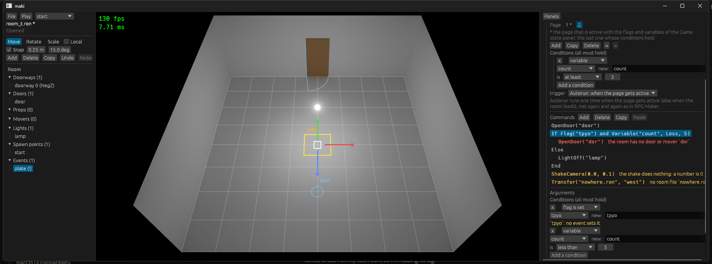

# Stage 29: event checks in the loader, event format

State: built. Gate: met. `OpenDoor("dor")` in a copy of `room_a.ron` stops the game at start with `room_a.ron:60: event `locked door`: the room has no door or mover `dor``, and the editor shows the same text on the row. The three room files load. `trip_720p` is byte-equal.

A test room in the editor. Page 2 has the condition "variable `count` is at least 3". The selected `If` has the condition widget of a page as its arguments. Red: an error of the loader. Yellow: a warning of the loader (a check of the game's `ShakeCamera`, a `Transfer` to a file that is not there), and the mark of the flag `tpyo` that no event sets.

## 1. What was built

- **Format** (`events`): `If(conditions, then, else)` with the `Vec<Condition>` of a page. `Condition::Variable(name, Compare, value)` with `Equals`, `NotEquals`, `Less`, `AtLeast` in place of the two variable kinds. `EventDef::area` is `Option<Area>`; `Area` has no "empty" value.
- **Checks** (`events/src/check.rs`): `CommandRegistry::check_events` finds two events with one name and runs, for each command, the check of its module (`CommandRegistry::add_check`). The built-in check (`builtin::check`) is added as that of any module. The loader and the editor call `check_events`.
- **Loader** (`scene`): a `RoomValidator` gets a `RoomCheck` (path, `RoomDef`, text) and returns `RoomProblem`s. An error stops the load, with all errors of the file in one message; a warning is logged.
- **Line of a command**: each command that is read from a text gets its number in the order of the text (`Command::order`). For a problem, the text is read a second time and the read stops with an error at that number: the parser gives the place of an error (`CommandRegistry::line`). The same for the name of an event.
- **Editor**: the condition widget of a page is the widget of an `If`. Problems are matched to a row by the command, not by its text. "Where used" and the pick lists of flags and variables mark a name that an event reads and no event writes.
- **Module check**: `game/src/shake.rs` adds a check for `ShakeCamera` (a warning for a shake of 0 seconds or 0 m).
- **Converter**: `tools/convert_rooms.py`, with `--selftest`.

## 2. Numbers

- `cargo test --workspace`: 121 tests, 122 with `--features editor`. `cargo clippy --workspace --all-targets` clean with and without `--features editor`. `cargo fmt --check` clean.
- Debug build with the validation layer: `--bench-frames 300` and `--bench-frames 900 --bench-script trip` with no error and no warning. The trip log has 8 event starts and 2 messages, as at stage 28.
- `python tools/bench.py same trip_720p p5base s29`: `ok`, byte-equal.
- `python tools/bench.py compare p5base s29`: `gpu_total` and `gpu_trace` of the 26 scenarios between -3.5 % (`trip_720p/gpu_trace`) and +3.2 % (`heavy_mixed_1080p/gpu_trace`). The stage changes no render code: this is the noise of the machine.
- The benchmark ran before the last two changes (the layout of the condition widget in the editor, and no start room check with `--editor`). The two are not in a run without `--editor`.

## 3. Files

New:
- `crates/events/src/check.rs`: `CheckContext`, `Finding`, `Problem`, `each_command`, `check_events`, the validator of the loader, the cache of the spawn points of other room files.
- `tools/convert_rooms.py`: the converter.
- `docs/part5/pictures/stage-29-if.png`.

Changed:
- `crates/events/src/model.rs`: `Compare`, `Condition::Variable`, `all_hold`, `area: Option<Area>`.
- `crates/events/src/command.rs`: `Command::order`, `add_check`, `line`, the read state with its counters.
- `crates/events/src/builtin.rs`: `If` with conditions, `check`.
- `crates/events/src/interpreter.rs`: an event with no area is never touched or faced.
- `crates/events/src/lib.rs`, `tests.rs`: exports, the validator; the test of the checks with their lines.
- `crates/scene/src/room.rs`, `lib.rs`: `RoomCheck`, `RoomProblem`, the new `RoomValidator`; a room from a text of a tool is not checked by the validators.
- `crates/editor/src/events.rs`: the checks are gone; `problems` calls `check_events`; `if_text`; `Names::never_written`.
- `crates/editor/src/event_panel.rs`: conditions for `If`, the compare list, the marks, colors for error and warning.
- `crates/editor/src/document.rs`, `ops.rs`, `overlay.rs`, `view.rs`, `panels.rs`, `lib.rs`: `Option<Area>`, `Document::read` with no validators.
- `game/src/shake.rs`: the check of `ShakeCamera`. `game/src/main.rs`: no `check_start_room` with `--editor`.
- `README.md`, `OPEN_ITEMS.md`, `CLAUDE.md` (the target block of part 5).

## 4. Deviations

- **The room files of the game did not change.** They have no `If`, no variable condition, and no area of size 0. `convert_rooms.py` reports "no change" for the three.
- **The editor opens a room with an error.** `Document::read` runs no validator, the loader runs none for a room that a tool gives as a text (`RoomTarget::text`), and `main.rs` does not check the start room with `--editor`. Without this a wrong name could not be set right in the editor, and the picture would stop at each wrong name while the user edits. The editor shows the problems from the same code.
- **"No text field"** of the gate is read as "no command typed as RON". The name of a new variable is typed one time in the "new:" field (stage 31 changes that picker, U4).

## 5. Decisions

- The commands of a page after a `Transfer` are not checked: they run in the other room (the trip of the game does `Transfer`, then `FadeIn`). Found by an old test that names a light of the next room.
- A problem of the loader has the line only, not the column: the read stops after the name of the command.
- `CheckContext::spawn` is a function, not a list: the loader reads a room file from the disk, the editor gives what it read at open and save.
- The loader keeps the spawn points of each other room file with the write time of the file. A room change reads a file again only after a write (watch point "disk reads in a frame").
- A check of a module returns one `Finding` for a command, or none.
- `Area` lost `Default`: a new area in the editor is 1 m x 1 m at the origin.
- A warning is logged each time the room is checked: at the start check and at each load.

## 6. Uncertain

- The editor reads another room file as a room only if its events read too; the loader needs only the room. For a neighbor with a bad event the editor says "no room file" and the loader says nothing.
- A list of commands in a command of another module is not walked by `each_command` (stage 33 makes "a command with lists" a trait). The line of such a command is still right: the number is given at the read.
- The mark "no event sets it" also shows for a flag that only the "Game state" panel sets. It is a hint.
- Play in the editor with an error in the events runs, and the event logs a warning, as before the stage. The status line gives the count at a save.

## 7. What to watch for: results

| Point | Result |
|---|---|
| The line of a command | The second read with a stop (section 1). Test `a_wrong_name_is_an_error_with_its_line...`: two equal `OpenDoor("dor")` in the two lists of an `If` give lines 11 and 12; the second event of a name gives the line of its name. |
| Disk reads in a frame | One `metadata` call for each `Transfer` target at a load; the file is read at the first check and after a write. |
| Two copies of the checks | `crates/editor/src/events.rs` has no `Builtin::OpenDoor`. `problems` is 15 lines that call `check_events`. |
| The converter and comments | `git diff game/assets/rooms`: empty. The self-test has a comment and a `Message` text with an old `If` in it: the two stay. |
| `trip_720p` | Byte-equal. 8 event starts. No warning: rooms A and B name each other and the two exist. |
| A flag with no write that is correct | A yellow mark, no error, not in the count of problems. |

## 8. Open items

- Removed: "Events with the same name", "Checks that only the editor makes".
- "Limits of the event format": rewritten with what is left.
