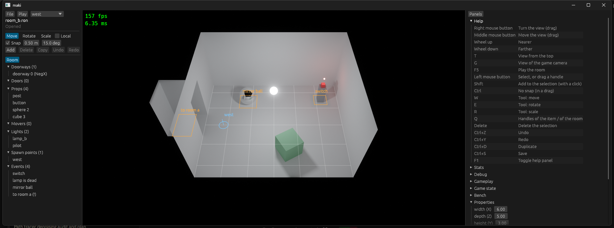

# Stage 30: key chords, saved settings, play signal

State: built. Gate: met. The editor has no `MODIFIER` action and no resource of another crate in `reset_play_state`. A grid step of 0.5 m is there after a restart. A press and a move in one frame select at the press place. A shake that runs does not go on after the play signal.

The editor after a restart: the grid step that was typed in the session before (0.50 m), and the help panel with the chords.

## 1. What was built

- **Chords** (`platform`): a `Binding` has a `Chord` (a key and its `Modifiers`). A table of a module has a `Key` for a plain key or `Chord::ctrl(Key::Z)`; the old tables did not change. Each key keeps the modifiers that were down at its press. A key starts the binding of its mode with the most modifiers among those that fit; so a chord wins over the plain key, and a key with no chord works with a modifier down.
- **Press place** (`platform`): `Pointer::press` is the place of the pointer at the press of a mouse button, in the frame of the press. The editor takes a click and the start of a drag there.
- **Saved settings** (`core`): `App::add_saved_settings` adds the settings and a system that writes the table to the config file 0.4 s after the last change of the resource. `ConfigFile::write` replaces the `key = value` lines of the table in the text; it proves that the new text has the new table and each other table as before, or it writes nothing. `[editor]` asks.
- **Play signal** (`core`): the schedule `ResetPlay`. `App::run` runs it after `Startup`; the editor runs it on play and stop. Systems in it: events (runner, message), scene (fade), gameplay (`MoveCapture`), game (`CameraShake`).
- **Editor**: `SNAP_SWITCH` on Ctrl (held), `ADD_TO_SELECTION` on Shift (held), four chords. `Editor::keys` tests no modifier.

## 2. Numbers

- `cargo test --workspace`: 125 tests, 126 with `--features editor`. `cargo clippy --workspace --all-targets` clean with and without `--features editor`. `cargo fmt --check` clean.
- Debug build with the validation layer: `--bench-frames 300` and `--bench-frames 900 --bench-script trip` with no error and no warning; 8 event starts. `config.toml` is byte-equal after the two runs.
- `python tools/bench.py same trip_720p s29 s30`: `ok`, byte-equal.
- `python tools/bench.py compare s29 s30`: `gpu_total` and `gpu_trace` of the 26 scenarios between -3.0 % (`heavy_mixed_1080p/gpu_trace`) and +2.1 % (`trip_720p/gpu_trace`). At stage 29 the same two rows moved by +3.2 % and -3.5 %: noise.
- By hand, in the editor with a config file with comments: "0.5" typed into the grid step. The file got an `[editor]` table at its end; the comment line, the comment after a value, and the tables `[window]`, `[render]`, `[rooms]` did not change. After a restart the field shows 0.50 m.

## 3. Files

Changed:
- `crates/platform/src/input.rs`: `Modifiers`, `Chord`, `Binding::chord`, the match of chords in `update_actions`, `Pointer::press`.
- `crates/platform/src/lib.rs`: exports; the test of the chords and the press place.
- `crates/core/src/app.rs`: `ResetPlay`, `App::reset_play`, `App::add_saved_settings`.
- `crates/core/src/config.rs`: `ConfigFile::write`, `text`, `save_settings`, `replace_table`; two tests.
- `crates/scene/src/lib.rs`, `crates/events/src/lib.rs`, `interpreter.rs`, `crates/gameplay/src/controls.rs`, `game/src/shake.rs`: the `ResetPlay` system of each module. `shake.rs`: a test.
- `crates/editor/src/lib.rs`: the binding tables, `keys`, `viewport`, `reset_play_state`, `add_saved_settings`.
- `crates/editor/src/tests.rs`: Ctrl+Z, Ctrl+Y, S alone, Ctrl+R, and a click with a move in its frame.
- `crates/ui/src/help.rs`, `events.rs`, `lib.rs`: the label of a chord.
- `README.md`, `OPEN_ITEMS.md`.

New: `docs/part5/pictures/stage-30-help.png`.

## 4. Deviations

- **`RawInput::KeyDown` has no place.** The place of a press is in `Pointer::press`, made from the order of the events of the frame (the OS sends the move before the press). The result is the one that the stage asks for, and no sender or reader of `RawInput` changed.
- **The play signal does not clear `GameState`.** The watch point asks for it: the editor plays with the flags that the user set in the "Game state" panel. The editor still keeps and puts back the `GameState` and asks for the room; they are its own work, not play state of a module. Who starts a new game (stage 38) clears the state.

## 5. Decisions

- The choice of a chord holds from the press of the key to its release. Ctrl up before Z: the chord action stays pressed and ends one time, with Z.
- A chord fits if its modifiers are down; other modifiers can be down too (Ctrl+Shift+Z is Ctrl+Z while no binding has the three).
- The repeat of a held key by the OS does not change the modifiers of its press.
- The write waits 0.4 s after the last change, by the clock of the wall: the editor pauses the time of the game.
- A table is written line by line, with no new crate. A value over more than one line, or a table in the table, is not written and an error is logged.
- `save_settings` runs in any order with the system that changes the resource (`ambiguous_with_all`).
- A `ResetPlay` system writes only a value that differs: the first frame of the game has no new change for the renderer.

## 6. Uncertain

- A change in the last 0.4 s before the game ends is not written.
- A comment after a value in a line that is replaced is lost. The comments of other lines stay.
- The outliner marks an event with a warning as it marks one with an error (`(!)`), found in this check: room B in a directory with no room A.
- `Editor::play` runs the signal and then asks for the room; a module that needs the new room in its reset does not have it yet. No module needs it now.

## 7. What to watch for: results

| Point | Result |
|---|---|
| Held modifiers in the game | Test `a_chord_wins_over_its_plain_key...`: W with Ctrl down is "forward" (no chord of W). In the editor: Ctrl+R is the scale tool (no chord of R); Ctrl+S saves and S alone saves nothing. |
| Key up of a chord | The same test: Ctrl up before the key, 4 frames: the plain action never starts, the chord action is released one time. |
| Which tables are written | Only a type of `add_saved_settings`: `EditorSettings`. The render and gameplay panels use `add_settings`. |
| Benchmark configs | A run with no editor has no saved table. `config.toml` byte-equal after two runs; `git status` shows no config file after `bench.py run`. |
| The schedule, not a list | `rg "EventRunner\|MessageBox\|ScreenFade\|MoveCapture" crates/editor/src/lib.rs`: two hits of `EventRunner`, the step mode and the start of a test page. None in `reset_play_state`. |
| `GameState` at stop | Not in the signal. The test `play_runs_the_game_and_stop_brings_back_the_room_and_the_game_state` passes. |

## 8. Open items

- Removed: "Key chords", "Play state of a module", "Place of the pointer at a click".
- "Config values at run time": rewritten with what is left.
