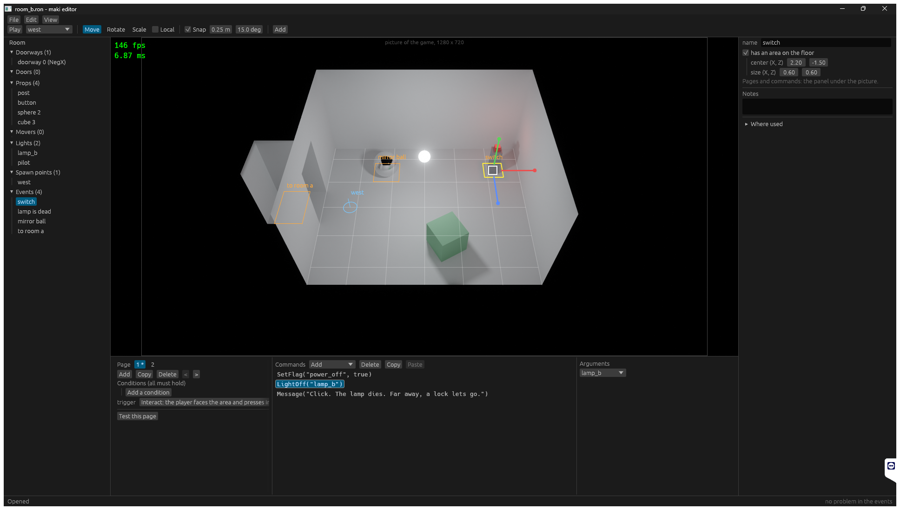
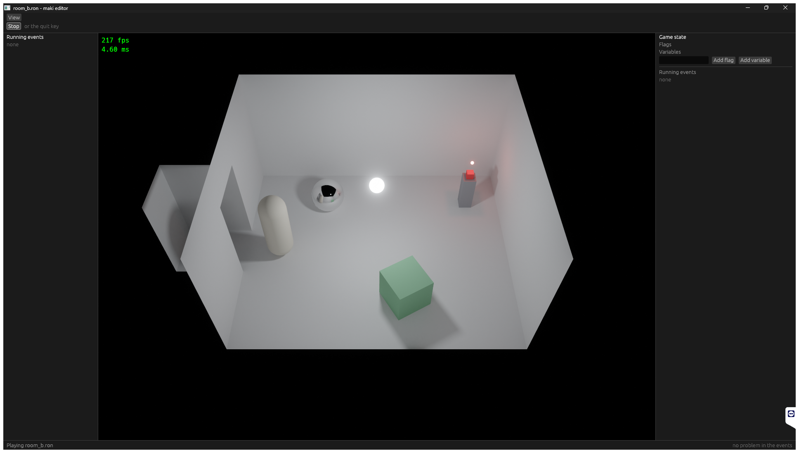
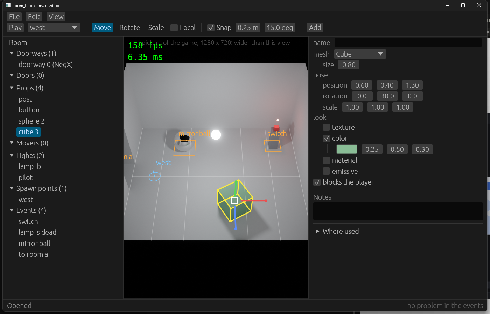

# Stage 31: editor window

State: built. Gate: met. With the default config the editor is a maximized window on a 1920 x 1080 display, with all panels in it. A resize of the window changes the picture, not the panels. After a resize, and at a UI scale of 1.5, a click selects the item under the pointer and the gizmo is at its item. `trip_720p` is byte-equal and the benchmark numbers are within noise.

Room B with the event `switch` selected, default config, 1920 x 1080. Top: menus and the tool row. Left: outliner. Right: properties (name, area, notes). Under the picture: pages, command rows, and the arguments of the selected row. Bottom: status row. The thin frame in the picture is the picture of the game (1280 x 720).

Play: "Stop" in the top row, the running events at the left, the game state at the right.

`[ui] scale = 1.5`, the window resized to 1400 x 900, then a click on the cube.

## 1. What was built

- **`Picture`** (`platform`): the place and the size of the picture in the window. `update_picture` writes it in `Extract`: from the `[window]` settings and the margin (the game, `PictureFit::Settings`), or from the window size and the margin (a tool, `PictureFit::Window`). The renderer (`extract_frame`), the UI (`run_ui`), and the editor (`editor_view`, `viewport`, the camera) read it.
- **`WindowMargin`** has four sides. `Gpu::copy_into` takes a corner (left, top). `WindowTitle` is a resource that sets the title bar.
- **Tool layout** (`ui`): `Panels::set_tool_layout`, `add_tool_panel` with `ToolPlace` (top, left, right, bottom, status). Side panels and the bottom panel have a size that the user drags. The debug panels of the game are one window ("View > Debug panels"), closed at the start. `[ui] scale`.
- **Editor panels**: menu bar (File, Edit, View) and tool row; outliner; properties; the event panel under the picture in three parts; the status row with a red error that stays until "x", and the count of errors and warnings of the events. In a game: stop and steps, running events, game state. The title is `room_b.ron * - maki editor`.
- **Saved sizes**: `left_width`, `right_width`, `event_height` in `[editor]`, by the seam of stage 30.
- **Picker**: one list with a search field for flags, variables, lights, doors and movers, room files, spawn points, and the commands of "Add". Flags and variables have the entry "New...".
- **Game frame**: in the view of the game camera, the frame of the picture of the game.

## 2. Numbers

- `cargo test --workspace`: 125 tests, 126 with `--features editor`. `cargo clippy --workspace --all-targets` clean with and without the feature. `cargo fmt --check` clean.
- Debug build with the validation layer, game: `--bench-frames 300` and `--bench-frames 900 --bench-script trip`, no error, no warning, 8 event starts; `config.toml` byte-equal after them.
- Debug build with the validation layer, editor: three sessions (default config; `[ui] scale = 1.5` with a resize from maximized to 1400 x 900; play and stop), no error and no warning of the layer.
- `python tools/bench.py same trip_720p s30 s31`: `ok`, byte-equal. Also `walk_720p` after the picture seam alone.
- `python tools/bench.py compare s30 s31`, 26 scenarios: `gpu_total` from -5.3 % (`heavy_1080p`) to +1.4 % (`textured_1080p`); `gpu_trace` from -2.9 % to +0.4 %. `gpu_compose` and `gpu_ui_overlay` did not move.
- Picture of the editor at 1920 x 1080: 1350 x 985 pixels with no event selected, 1350 x 685 with the event panel open.

## 3. Files

Changed:
- `crates/platform/src/window.rs`, `lib.rs`: `Picture`, `PictureFit`, `update_picture`, `WindowTitle`, `WindowMargin` with four sides, a maximized window for a tool.
- `crates/gpu/src/lib.rs`: `copy_into` with a corner.
- `crates/render/src/lib.rs`, `passes.rs`: the picture from `Picture`; a new picture size starts the picture again.
- `crates/ui/src/lib.rs`: the tool layout, `ToolPlace`, `PanelSizes`, `UiSettings`. `crates/ui/src/events.rs`: `game_state_panel` is a public function. `crates/ui/Cargo.toml`: `serde` (a crate of the workspace).
- `crates/editor/src/panels.rs`: all panels on the new places.
- `crates/editor/src/event_panel.rs`: `picker`, `name_list`; `event_properties`, `event_panel` in three parts, `pages`, `command_rows`, `command_arguments`.
- `crates/editor/src/lib.rs`: the panel sizes in `EditorSettings`, `Editor::error`, `title`, `Command::DebugPanels`, the open state of the event panel.
- `crates/editor/src/overlay.rs` (game frame), `camera.rs`, `view.rs`, `tests.rs`.
- `README.md`, `OPEN_ITEMS.md`.

New: three pictures in `docs/part5/pictures/`.

## 4. Deviations

- **The picture size follows a resize after 8 frames of rest**, not in each frame of the drag. In the drag the picture keeps its size and its corner follows; the window cuts it. This is the answer to the watch point "resize cost".
- **150 % was checked with `[ui] scale = 1.5`**, not with the scale of the OS: a change of the display settings of the machine is not an action of this session. egui gets one number for the two (pixels in one point), so the layout code is the same.
- **"Where used" is a fold at the end of the properties**, not a panel of its own.

## 5. Decisions

- The margin is what the UI measures (the sizes of its panels); `update_picture` in `platform` is the one place that makes the picture from it. A tool sets `PictureFit::Window`.
- `update_picture` runs in `Extract`, before `extract_frame`: a change of `[window]` by the benchmark reaches the renderer in the same frame, as before the stage.
- A tool window starts maximized. The size that the user gives it is not saved.
- The debug window is toggled by a command of the editor: a panel function does not have the `Panels` resource.
- The event panel is open while the last selected item is an event and no game runs.
- The search field of a picker takes the keyboard while its list is open; Enter takes the first name that the search leaves.
- An error of a command goes to `Editor::error`, not to the status text. An open or a save that works closes it.
- The panel sizes are saved as whole points.

## 6. Uncertain

- A window that is not maximized starts at the size of `[window]` in the game only; the editor always starts maximized.
- The label of the game frame and the frame counter are at the same place when the picture is narrow (third picture).
- The game in the editor has the shape of the view, not 16:9.
- F1 opens and closes the help section, which is in the debug window in the editor.
- `Place::Left` of `add_left_panel` and the left place of a tool are the same place; no module but the editor adds a left panel.

## 7. What to watch for: results

| Point | Result |
|---|---|
| The game did not change | `trip_720p` and `walk_720p` byte-equal; `gpu_compose` and `gpu_ui_overlay` equal; the code of `Place::Column` is as it was. |
| Rule 2 and rule 3 | `Picture` has four `u32`. It reaches the renderer in `extract_frame`. `copy_into` takes a tuple. |
| Resize cost | 8 frames of rest (section 4). No validation message in a resize from 1936 x 1096 to 1400 x 900. |
| Aspect ratio | The frame of the game picture in the view of the game camera; if the game picture is wider than the view, a line of text says so. |
| Pointer offset | `rg "WindowMargin" crates/editor`: no hit. `Picture::from_window` is the one place. |
| Event panel height | 300 points at the start: the picture is 1350 x 685 at 1080 pixels (first picture). |
| The search field takes the keyboard | The field has the focus while the list is open (`request_focus`), and `InputCapture::keyboard` is then true. Typed "pil" into the light list: the tool did not change. |

## 8. Open items

- Removed: "Size of the editor window".
- "Display scale other than 100 %": the check with `[ui] scale` is in the row; a display with another OS scale is still not tested.
