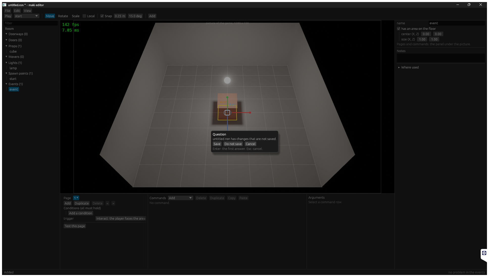
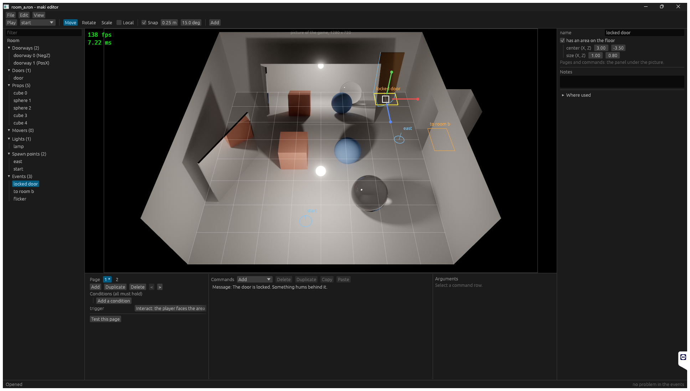

# Stage 32: editor UX

State: built, with 3 findings done in part and 1 part of the gate not done. Gate: each finding of the stage is fixed or has its reason below (section 4). **The hand session of one hour was not done**: this session drives the editor with scripted clicks and screenshots, and a key of the keyboard does not reach the game from that script. What was checked by hand is in section 6. The session of one hour is for the owner.

"New room" with changes that are not saved: the question is modal, in the middle of the window. The new prop has the name `cube`.

Room A, the event `locked door`: the command row is text for a reader. The properties have a label column and units.

## 1. Step 1: the findings before the fixes

Not from a hand session of 20 minutes. Each finding was read again in the code at `0084de4`, and some were seen in the sessions of stages 29 to 31.

| # | Result | How |
|---|---|---|
| U1 | Confirmed | `Command::Delete` took `Editor::selection` only (`lib.rs`). |
| U2 | Confirmed | `Command::SaveAs` set the path and saved. |
| U3 | Confirmed | `asks` had `Play` and `Test`. Seen in stage 29: the editor did not close with a change. |
| U5 | Confirmed | `add_window(CONFIRM)`: a window at the bottom of the picture, the panels took input. |
| U12, U14, U15, U16 | Confirmed | No such binding and no such code. |
| U13 | Confirmed | No hover state in `overlay.rs`. |
| U17, U18, U19 | Confirmed | Seen in stage 30: `to room a (!)` in the color of the others. |
| U20 to U24 | Confirmed | Seen in the pictures of stage 31. |
| U26 | Done in stage 31 | The star text is the hover text of a page tab. |
| U27 to U31 | Confirmed | Seen in stage 31: rows as RON, "< here". |

New, found in this stage:

| # | Finding | State |
|---|---|---|
| N1 | Esc stops a game (the quit key) and the same press was "cancel" in the editor: the selection would go away at each stop. | Fixed: the press that stops a game is not a cancel (`Editor::ignore_cancel`). |
| N2 | F5 held over the change of the input mode would play and stop in turns. | Fixed: one action (`PLAY`) in the two modes. |
| N3 | A new room that was not touched asks "changes that are not saved" at quit and at "New room". | Open. `Document::new_room` is `dirty`: the file does not exist. |
| N4 | The trigger list in the left part of the event panel is cut at its right edge. | Open. |
| N5 | The outliner mark of an event does not tell an error from a warning (stage 30). | Fixed with U18: red or yellow. |

## 2. What was built

- **U1**: `EventUi::focused` tells which list had the last click. `Editor::run` sends Delete, Duplicate, Copy, and Paste to the command rows (`row_command`) or to the items. Ctrl+C and Ctrl+V are chords.
- **U2, U5**: `Command::SaveAs` to the file of another room waits for `Answer::Replace`. The question is `maki_ui::add_modal` (`egui::Modal`); the keys of the editor do nothing while it waits; Enter and Esc answer.
- **U3**: Play and Test ask nothing. `maki_scene::RoomOverride` gives the loader the text of the document for its path while the editor plays.
- **U12**: `Command::Frame` (F, double click on an outliner row, the context menu).
- **U13**: `Editor::hover`: the handle or the item that a click would take, found only when the pointer is at a new pixel. The overlay shows it.
- **U14**: `Command::Cancel` (Esc): `Drag::cancel` puts the room and the events of the drag start back; with no drag it clears the selection.
- **U15**: F5 stops a game.
- **U16**: a step of `History` holds the selection of its state.
- **U17** (part): filter field, context menu (frame, duplicate, delete), a name for a new prop.
- **U18**: red or yellow event rows with hover text; the count in the status row is a menu of the problems; a click goes to the event, the page, and the row (`EventUi::go_to`).
- **U19**: a place of the open room in "Where used" is a link.
- **U20** (part): a label column, units from the label, X, Y, Z in the colors of the gizmo.
- **U21**: `widgets::file`: a texture and a glTF file from the list of the files, with the picker of stage 31.
- **U22, U23, U24**: doorway labels; the direction in the cone group; "Duplicate" for a page.
- **U27**: a line above the row where a dragged command goes.
- **U28** (part): Shift and a click selects a range of rows in one list; delete, duplicate, copy, paste take it.
- **U29, U30**: `CommandRegistry::add_texts`: a module gives the row text and one line of help of its commands. The built-in ones are in `events/src/builtin.rs`, `ShakeCamera` in `game/src/shake.rs`.
- **U31**: `key_of` reads the binding table for the hover text of Play, the tools, "Local", the row buttons, and the "Edit" menu.

## 3. Numbers

- `cargo test --workspace`: 126 tests, 127 with `--features editor`. `cargo clippy --workspace --all-targets` clean with and without the feature. `cargo fmt --check` clean.
- Tests that the stage asks for: `a_command_goes_to_the_list_of_the_last_click_and_no_work_is_lost_with_no_question` (U1, U2, U3, U14, U16, U28, in the editor with a headless app); `each_change_is_one_step_of_the_history` (U16); `a_command_is_read_from_its_text` (U29, U30).
- Debug build with the validation layer: the game with `--bench-frames 300` and the trip script, and one editor session: no error, no warning.
- `python tools/bench.py same trip_720p s31 s32`: `ok`, byte-equal. 8 event starts in the trip log.
- `python tools/bench.py compare s31 s32`, 26 scenarios: `gpu_total` from -2.1 % (`static_1080p`) to +5.2 % (`heavy_1080p`). `heavy_1080p` was 5.033 ms at stage 30, 4.768 ms at stage 31, and is 5.014 ms now: the step of stage 31 back, by the noise of the machine. The stage changes no code of the renderer, and the game has no editor code.

## 4. Findings that are not done, or done in part

| # | What is missing | Why |
|---|---|---|
| U17 | Rename in the row (F2, double click on the text). | A double click on a row frames the item (U12); a rename in the row needs a third state of a row. The name field of the properties does the rename. |
| U20 | A real grid of two columns. | A label column of a fixed width gives values in one column in each group; an indented group starts its column further right. |
| U28 | A drag of a range of rows. | `move_command` moves one command. Copy, paste, and delete of a range do the same work in two steps. |
| U13 | The time of the pick in a room with a model file. | No room of the game has a model file (stage 37). The pick runs only for a new pixel of the pointer. |
| U25 | - | Not planned (`ux-pass.md`). |
| Gate | The hand session of one hour, with five props, two lights, three events from "New room". | See the first paragraph. |

## 5. Files

Changed:
- `crates/scene/src/room.rs`, `lib.rs`: `RoomOverride`.
- `crates/ui/src/lib.rs`: `add_modal`.
- `crates/events/src/command.rs`, `builtin.rs`, `lib.rs`, `tests.rs`: `add_texts`, `row_text`, `help`.
- `game/src/shake.rs`: the texts of `ShakeCamera`.
- `crates/editor/src/lib.rs`: the new commands and bindings, `rows`, `Hover`, `key_of`, the routing by `focused`.
- `crates/editor/src/event_panel.rs`: `RowCommand`, `row_command`, the range, `go_to`, `described_list`, the drop line.
- `crates/editor/src/panels.rs`: the modal question, the outliner (filter, context menu, colors), the status menu, the links of "Where used", keys in hover texts.
- `crates/editor/src/widgets.rs`: `label`, `unit`, `vector` with X, Y, Z, `files`, `file`.
- `crates/editor/src/ops.rs` (history with selection, prop names), `gizmo.rs` (`Drag::cancel`), `overlay.rs` (hover), `tests.rs`.
- `README.md`, `OPEN_ITEMS.md`.

New: two pictures.

## 6. What was checked by hand, and the list of the session

A session of about ten minutes, with scripted clicks, in room A and in a new room:

- Room A opens; the properties of the room show `8.00 m`; the filter field is above the outliner.
- A click on the event `locked door`: the row is `Message: The door is locked. Something hums behind it.`; the page buttons are Add, Duplicate, Delete.
- "File > New room" with no change: no question. "Add > Cube": the prop is `cube`. "Add > Event area", then "File > New room": the modal question; "Do not save" opens the new room.
- The close button with the new room: the question again (N3); "Do not save" ends the editor. No `untitled.ron` was written.

Places where the user would stop, from this session and from the work on the stage:

1. N3: the question for a new room that was not touched.
2. N4: the cut trigger list.
3. A new event has the name `event` and one empty page: the first thing to do is a rename and "Add" of a command; there is no template.
4. The name of a new flag or variable is typed after "New..." in a field of the picker; no list of the flags of the game is in view while the user types (it is in "Where used").
5. A light has no handle for its cone: the direction is three numbers (stage 35).

Not checked by hand, only by the test or by the code: the keys (Delete, Ctrl+C, Ctrl+V, F, Esc, F5), the hover marks, the context menu, the links of the status row and of "Where used", the file pickers, the drop line.

## 7. Deviations

- Step 1 is a read of the code, not a hand session (section 1).
- A new prop gets a name (`cube`). Room files that the editor made before have props with no name; they keep their label by index.
- `RowCommand` is public: `Command::Delete` and the three others carry no list, and a module of a game could ask for a row command.

## 8. Decisions

- Which list gets a command is one flag (`EventUi::focused`), set by a click on a row and cleared by each selection of an item.
- Copy and paste do nothing for items, with a status text (a buffer of items is stage 39).
- A problem names its row by the command (stage 29), so the new row texts changed no mark.
- `RoomOverride` is a resource of `scene`, not a field of the request: a `Transfer` of the game makes the request.
- The unit of a number comes from its label (`widgets::unit`), with a note in the code.
- The selection of a history step is that of the last frame in which the document had that state.

## 9. What to watch for: results

| Point | Result |
|---|---|
| U1 is a rule | The test: Delete, Duplicate, Copy, Paste with a row selected, Undo, then an item selected and Delete again. |
| U3 and the file on disk | The test: a change, play, room B, a load of room A: the room of the editor (`width` 7). After stop: the change and the mark are there, `RoomOverride` is `None`. |
| U13 cost | A pick for a new pixel only. Not measured with a model file (section 4). |
| U14 and the history | The test: the number of steps is the same after a drag that Esc ended. |
| U29, U30 and rule 5 | `rg ShakeCamera crates/`: only the doc comment of `events/src/command.rs`. The texts are in `game/src/shake.rs`. |
| U30 and the checks | A `Problem` has the command (`Problem::command`), and the row is found by it. |
| Too much at one time | 20 of 23 done, 3 in part (section 4). |
| The hand session is the gate | Not done (first paragraph). |
