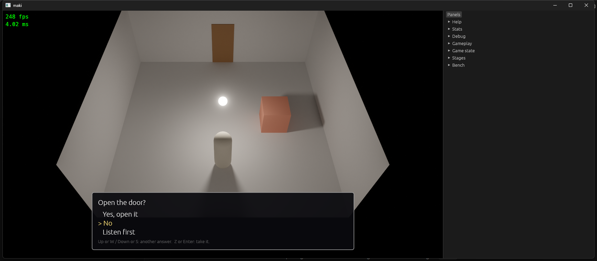

# Stage 33: choices and the text box

State: built. Gate: met. A question with its answers is made in the editor (the command, an answer, a command in the list of an answer; the saved text reads as the same events), and in the game each answer runs its list.

The game, a test room: the box at the bottom of the picture, with the mark at the second answer. "No" then ran its list (a message).

## 1. What was built

- **Lists in a command** (`events`): `CommandRegistry::add_lists(get, set)`. `get` gives the lists of a command with the label of each; `set` makes the command again with other lists. `CommandRegistry::lists`, `with_lists`, and `each_command` are what all other code uses. The built-in commands add theirs as a module does (`builtin::lists`, `builtin::with_lists`).
- **Choice**: `Builtin::Choice(question, [(answer, commands)])`. It writes `MessageBox` (the question) and the new `ChoiceBox` (the answers and the mark), reads `CHOICE_UP`, `CHOICE_DOWN`, and `INTERACT`, and opens the list of the answer with `Step::open`. A check of the loader: a question needs an answer. A row text and a line of help.
- **Text box** (`ui/src/events.rs`): an overlay at the bottom of the picture, as wide as the picture up to 760 points: the text, the answers with a mark, and the keys from the binding table. It takes the place of the egui window.
- **Editor**: a `ListPath` names a list by its index; `RowKind::Branch(n)` is the label row of list `n` (`Else`, `Answer: Yes`). `list`, `edit_list`, `rows`, `Row::insert_place`, `rename_in_events`, `spawn_users`, and the names walk the lists by the registry. The arguments of a `Choice`: the question, and the answers with add and remove.
- `ResetPlay` clears a question.

## 2. Numbers

- `cargo test --workspace`: 127 tests, 128 with `--features editor`. `cargo clippy --workspace --all-targets` clean with and without `--features editor`. `cargo fmt --check` clean.
- New tests: `a_question_runs_the_list_of_the_answer_that_the_player_takes` (events: keys, the two ends of the mark, the press that closes a message, the line of a wrong name in the list of the second answer, a question with no answer); the `Choice` part of `the_rows_of_a_page_show_the_lists_of_a_command_and_a_change_in_them_makes_it_again` (editor).
- Debug build with the validation layer: `--bench-frames 300`, the trip script (8 event starts), and a session in a room with a message and a question: no error, no warning.
- `python tools/bench.py same trip_720p s32 s33`: `ok`, byte-equal.
- `python tools/bench.py compare s32 s33`, 26 scenarios: `gpu_total` from -3.3 % (`heavy_mixed_1080p_raw`) to +1.5 % (`heavy_mixed_1080p`); `gpu_ui_overlay` did not move. The benchmark ran before two changes with no effect on the game binary's work (a `mut` in a test, type names in `command.rs`).

## 3. Files

New: `docs/part5/stage-33-choices-and-text-box.md` (the stage file), `docs/part5/pictures/stage-33-question.png`.

Changed:
- `crates/events/src/command.rs`: `add_lists`, `lists`, `with_lists`, `each_command`.
- `crates/events/src/builtin.rs`: `Choice`, `lists`, `with_lists`, its text, help, and check.
- `crates/events/src/interpreter.rs`, `lib.rs`: `ChoiceBox`, `Choices`, the two actions with their keys.
- `crates/events/src/check.rs`: the free function `each_command` is gone.
- `crates/ui/src/events.rs`: `text_box`.
- `crates/editor/src/events.rs`, `event_panel.rs`, `ops.rs`, `panels.rs`: the lists by the registry, the `Choice` widget.
- `README.md`, `OPEN_ITEMS.md`.

## 4. Deviations

- "A trait of the command set" is a pair of functions that a module gives to the registry (`add_lists`), as `add_check` and `add_texts` are. `CommandSet` is a blanket trait for each enum with the serde derives: a method on it would need a hand-written impl for each enum.
- The question was made in the editor by the test, not by hand in the window. The game was checked by hand with a room file that was written as text.

## 5. Decisions

- The label of a list is a text of the command set; an empty label is no row (the first list of an `If`).
- The mark does not wrap. Up and down are the arrow keys and W, S.
- A `Choice` starts with one wait step: the press that closed a message before it is not its answer.
- `ChoiceBox` is a resource beside `MessageBox`: `MessageBox` did not change.
- The row of a command in the event panel is the reader text of its module, also for the uses in "Where used"; `if_text` of the editor is gone.
- A new `Choice` of the "Add" list has the answers "Yes" and "No".
- Removing an answer in the arguments removes its commands with it.

## 6. Uncertain

- The arrow keys were not checked by hand (the script of this session sends them with no extended flag); W, S, and Z were. The test sends `ArrowUp` and `ArrowDown` as key messages.
- A `Choice` in a `Parallel` event: the player walks with W and S while the mark moves with the same keys. Not tried.
- The box has one size of text; a long text makes the box higher with no limit.
- `crates/editor/src/events.rs` still matches `Builtin::If`, for its conditions (the names that it reads), not for its lists.

## 7. What to watch for: results

| Point | Result |
|---|---|
| One walk | `rg "Builtin::If" crates/editor crates/events/src/check.rs`: the argument widget, the "Add" entry, and the conditions of the names. No list of an `If` is matched outside `builtin.rs`. |
| The line of a command in a list | The test: `OpenDoor("dor")` in the list of the second answer is line 12 of the file. |
| The keys of the mark | Not tried in a `Parallel` event (section 6). |
| A press that does two things | The test: after the press that closes the message, the question shows with the mark at the first answer and no list ran. |
| The box and the picture size | Width: the picture less a margin, 120 to 760 points. Seen at 1280 x 720. |
| Row kinds | The test: `Question`, `Answer: Yes`, `Answer: No`, a command in the second list, `End`; a new command goes to the list of the selected label row. |

## 8. Open items

- Removed: "Message window".
- "Dialogue with choices, a graph view, scripts" is now "A graph view of events, scripts".
- "Limits of the event format": lists of a module are walked.
