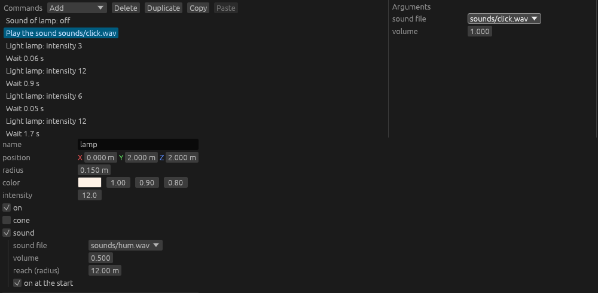

# Stage 34: sound

State: built. Gate: met by the log and the audio state. **Nobody listened**: the owner accepted a check with no ears for this stage, and the two sound files are placeholders.

- The switch of room B clicks: the trip script logs `sound event="switch" file=sounds/click.wav`.
- The lamp of room A hums and stops with the power: `sound at a place starts` when room A loads; on the way back, with the power off, `sound of the room event="flicker" name="lamp" on=false` and `sound at a place stops`.
- Stop in the editor ends all sound: `all sound stops effects=0 sources=1 music=false` in the running editor, and no start after it; a test does the same with music, a sound, and a hum.

The editor, room A: the rows and the arguments of a `PlaySound` that "Add" made (the file is picked from a list), and the sound of the lamp in its properties.

## 1. What was built

- **Crate `audio`** (`crates/audio`), after `events` in the crate order. `kira` 0.12.5 is the output; `output.rs` is the only file that names it.
  - `Audio`, a resource: `load` (a sound file as an asset with a handle, one load for each file), `play`, `play_music` (a loop from a stream), `stop_music`, `stop_all`, `set_volume`. `music`, `effects`, and `sources` tell what plays.
  - `[audio]`: `volume`, `output`. With `output = false`, or with no device, the same code runs on the mock backend of `kira`: the module renders the time of each frame into nothing, so a sound starts, fades, and ends as with a device.
  - `ResetPlay` stops all sound and forgets the loaded files.
- **A sound at a place**: `maki_scene::SoundSource` (file, volume, reach, on), a component. The room file: `sound: (file, volume, reach, on)` of a light. The audio module plays each entity with the component, in `Extract`, while it is on and the game is not paused: a track at the place of the entity, the listener at the player, turned as the camera is. Start and stop fade for 0.5 s.
- **Commands** (`AudioCommand`, from the audio module): `PlaySound(file, volume)`, `PlayMusic(file, volume)`, `StopMusic`, `SoundOn(name)`, `SoundOff(name)`. Checks of the loader: a file that is not there is a warning, a name with no sound is an error. Row texts and help.
- **Editor**: the sound of a light in its properties. The audio commands: "Add" makes them with arguments that exist; the arguments are a file picker, a number, and a list of the lights with a sound. A rename of a light changes `SoundOn` and `SoundOff`.
- **Seams for a module**, used by the audio module and open to a game:
  - `CommandRegistry::add_defaults`: the new command of a name for the "Add" list. `ShakeCamera` uses it too.
  - `add_argument_editor` gives the open room to the widgets; `maki_editor::widgets` has `number`, `file`, and `pick` as public functions.
  - `CheckContext::directory`: the directory of the room file, for the check of a file name.
- **Content**: `tools/gen_sounds.py` makes `click.wav` (60 ms) and `hum.wav` (1 s, loops with no step). Room B: `PlaySound` in the switch event. Room A: the lamp has the hum, and the `flicker` list starts with `SoundOff("lamp")`.
- **A bug that the check found, older than this stage**: the play key (F5) in a game queued a stop and then a play, so the game started again. The key now stops the game. The Stop button and the quit key did work.

## 2. Numbers

- `cargo test --workspace`: 132 tests, 133 with `--features editor` (5 new). `cargo clippy --workspace --all-targets` clean with and without `--features editor`. `cargo fmt --check` clean.
- New tests:
  - `the_commands_of_a_room_file_start_and_stop_sounds_with_no_device` (audio): each command of a room file, the end of a short sound, a paused game, 200 clicks, a file that is not a sound, the play signal.
  - `the_loader_checks_the_names_and_the_files_of_the_audio_commands` (audio): the warning, the error with its line.
  - `the_right_side_of_the_picture_is_the_right_ear` (audio).
  - `a_sound_command_is_added_with_arguments_and_a_rename_of_its_light_follows` (editor).
  - `stop_ends_all_sound_and_a_room_that_the_editor_shows_is_silent` (editor): play, then the play key held for 6 frames. It fails without the fix of the play key.
- Debug build with the validation layer and a sound device: `--bench-frames 300`, the trip script (8 event starts), and a session in the editor: no error. The two runs of the game: no warning. The editor: one `slow frame` warning in its first frame, as before this stage.
- `python tools/bench.py same trip_720p s33 s34`: `ok`, byte-equal.
- `python tools/bench.py compare s33 s34`, 26 scenarios: `gpu_total` from -6.0 % (`heavy_mixed_lights8_1080p`) to +1.6 % (`trip_720p`, `static_1080p`); `gpu_ui_overlay` did not move. The benchmark runs with `audio.output = false`.
- The benchmark ran before two changes: a log line in `Audio::stop_all`, and the fix of the play key (editor only). `trip_720p` was run again with the last binary: byte-equal.
- Decode time on the calling thread, debug build: the hum (1 s) 1.7 to 2.4 ms, the click 0.35 to 0.5 ms.

## 3. Files

New:
- `crates/audio/Cargo.toml`, `src/lib.rs` (module, settings, the system of the frame), `src/output.rs` (`Audio`, `Sound`, all of `kira`), `src/commands.rs` (`AudioCommand`), `src/tests.rs`.
- `crates/editor/src/audio.rs`: the argument widgets of the audio commands.
- `tools/gen_sounds.py`, `game/assets/rooms/sounds/click.wav`, `hum.wav`.
- `docs/part5/stage-34-sound.md` (the stage file), `docs/part5/pictures/stage-34-sound.png`.

Changed:
- `Cargo.toml`, `Cargo.lock`: `kira` (features `cpal`, `wav`, `pcm`, `ogg`, `vorbis`), the crate order.
- `crates/scene/src/lib.rs`, `room.rs`: `SoundSource`, `SoundDef`, `LightDef::sound`; `patch_room` loads the room again for a sound that changed.
- `crates/events/src/command.rs`, `check.rs`: `add_defaults`, `new_command`, `CheckContext::directory`.
- `crates/editor/src/event_panel.rs`, `widgets.rs`, `panels.rs`, `ops.rs`, `lib.rs`, `document.rs`, `events.rs`, `tests.rs`: the seams above, the sound of a light, the rename, the play key.
- `game/src/main.rs`, `shake.rs`, `game/assets/rooms/room_a.ron`, `room_b.ron`.
- `tools/bench.py`: `audio.output = false`.
- `CLAUDE.md` (crate list, rule 1, stack), `README.md`, `OPEN_ITEMS.md`.

## 4. Deviations

- **Place in the crate order.** `MISSING.md` says "after `assets`, before `scene` or beside it". The crate is after `events`: its module adds the commands, and it reads the components of the scene. `gameplay` is after it and can play a sound.
- **Only a light has a sound.** The plan says "a prop or a light that hums". The component is on any entity; the room file has the field for a light only. A sound with no light is a light that is off.
- **"Both set in the editor".** The click and the hum of the game were written into the room files as text. In the editor they were set on a copy of room A (the picture above) and by a test; the game files were not saved from the editor.
- **No ears.** As the owner decided. Level, place, and the fades were not judged.

## 5. Decisions

- The audio module plays the sounds at a place in `Extract`, from the state of the frame, as the renderer draws. A command writes `SoundSource::on` and does not call the output.
- The listener is at the player, with the turn of the active camera: right in the picture is the right ear. With no player it is at the target of the camera.
- A sound at a place is full volume up to 1 m (or half its reach) and silent at its reach (default 12 m), with the linear falloff of `kira`.
- A paused game (`Time::paused`: the editor while it does not play) plays no sound at a place.
- `PlayMusic` with the file that plays changes nothing: an event of each room can ask for the music of the game.
- `StopMusic` fades for 1 s. The play signal ends each sound in 10 ms, not with a cut.
- The play signal forgets the loaded files: a file that the owner replaces while the editor is open is read at the next play.
- Volumes are factors (1.0: as the file), in the room file and in the config.
- The sound files are in `game/assets/rooms/sounds`: a path of a room file starts at its directory, and the file picker lists that directory and one level below.
- The editor crate depends on `maki_audio` and adds its argument widgets with the public seams. A game does the same for its own commands.
- With no device the mock backend runs at 7680 Hz: one buffer is one frame of 60 Hz.

## 6. Uncertain

- Nobody listened (section 4).
- No Ogg Vorbis file was loaded: the feature is on, the game and the tests have WAV files only.
- "No device" was tested with `output = false`. A device that fails to open takes the same path, by the code; this machine has a device.
- Music was played from a WAV file through the silent output only.
- In a game that the editor plays, F5 is also "reload the room" of `RoomsModule`: the room loads a second time just after play starts (in the log; older than this stage). The hum starts again with it. Not changed.
- `kira` brings a second version of `glam` (0.33) into the build.

## 7. What to watch for: results

| Point | Result |
|---|---|
| The picture | `same trip_720p s33 s34`: `ok`. The hum stops with a command in the `flicker` list; no new event. |
| No device | The tests run with `output = false` (`has_device()` is false in the test). `bench.py` sets `audio.output = false`. |
| A sound that ends | The test: a click of 0.05 s is gone after 12 frames; after 200 clicks, less than 8 are kept. |
| The hum on the way back | It starts when the room loads and is stopped 24 ms later (2 frames). The fade of `kira` is linear in decibels from -60 dB: the hum is at -57 dB then. Not heard by the numbers; not by an ear. |
| Stop in the editor | The test, and the running editor: `all sound stops`, no start after it, the toolbar shows "Play". Found on the way: the play key did not stop the game (section 1). |
| A write in each frame | `--bench-script walk` with `maki_render=trace`: one `a light changed` (the load), none after. |
| A file that changed | `stop_all` drops the cache; the log has `sound loaded` at each play in the editor. |
| A long frame | 1.7 to 2.4 ms for the hum in a debug build (section 2). |

## 8. Open items

- New row: "Sound: what stage 34 left".
