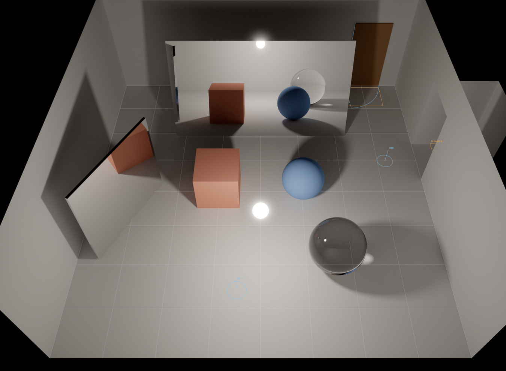
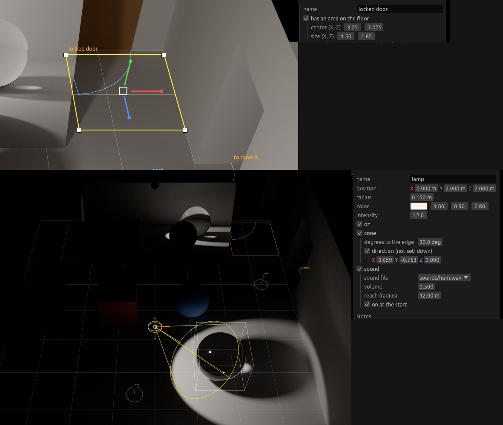

# Stage 35: marks with depth, missing handles

State: built. Gate: met. In the running editor the grid does not show on the cube, the sphere, the glass ball, and the two mirrors of room A; the lamp of room A was aimed, and the area of "locked door" was sized, with the mouse.

Room A in the view of the game camera: the grid is on the floor only.

Top: the area of "locked door" after a drag of its corner handle (center and size are on the grid of 0.25 m; the corner across did not move). Bottom: the lamp as a cone light after a drag of its aim handle; the direction is the result.

## 1. What was built

- **Distances of the picture** (`crates/render/src/distance.rs`): `read_distances` copies, from the image `normal` of the trace pass, the distance from the camera of each second, third, ... pixel (at most 1024 columns). `Distances::at` gives the distance at a place of the picture. The editor does not know the image or its format.
- **The cut** (`crates/editor/src/overlay.rs`): `MarkDepth` has the distances and the mirror meshes of the room. `read_depth` reads them after the picture changed (the sample count of the renderer started again), not at rest. A line of a mark is tested at steps of 3 pixels, and the parts that no surface hides are drawn.
  - Cut: the grid, and the event areas, spawn points, door swings, and second poses of movers of items that are not selected and not under the pointer, with their names.
  - On top, as before: the selection, the item under the pointer, the gizmo.
- **Mirrors**: the pixel of a mirror has the distance of what the mirror shows. `view::Mirrors` has the triangles of each mesh with the `Mirror` material, and a ray to the point is tested against them (a box test first).
- **Handles of the item itself** (`gizmo.rs`, `Extra`), white squares, with each tool:
  - `Handle::Aim`, a cone light: at the point of the floor that the middle of the cone meets. A drag sets the direction to the point of the floor under the pointer.
  - `Handle::Corner`, an event area: its four corners. A drag moves the corner on the floor; the corner across stays.
  - `Handle::Corner`, a doorway: its two top corners. A drag on the plane of the wall changes width, offset, and height; the other side stays. A doorway has a gizmo now (corners only).
  - They snap to the grid as a move does.
- **Group turn**: a turn of more than one item turns each place around the gizmo, and each rotation as before.
- **Mover**: a move and a turn take the two poses. With the checkbox in the properties, pose `b` only.
- **`Gpu::read_image_with`**: the read of an image with a function that takes what it needs. The readback buffer is in memory that the CPU reads fast (`GpuToCpu`).

## 2. Numbers

- `cargo test --workspace`: 138 tests, 139 with `--features editor` (6 new). `cargo clippy --workspace --all-targets` clean with and without `--features editor`. `cargo fmt --check` clean.
- New tests: `a_place_of_the_picture_gives_the_distance_of_its_texel` (render); `a_line_is_cut_where_a_surface_is_in_front_of_it`, `a_mirror_hides_what_is_behind_it` (editor, overlay); `a_drag_of_the_aim_handle_points_a_cone_light_at_the_floor`, `a_drag_of_a_corner_sizes_an_event_area_and_a_doorway`, `a_turn_of_two_items_turns_the_group_and_a_move_takes_the_two_poses_of_a_mover` (editor, gizmo). The ray against a box is in the ray test of `view.rs`.
- Debug build with the validation layer: `--bench-frames 300`, the trip script (8 event starts), and a session in the editor: no error. The two runs of the game: no warning.
- `python tools/bench.py same trip_720p s34 s35`: `ok`, byte-equal.
- One read of the distances, debug build, a picture of the editor on a display of 3840 x 2160: 6 ms with the GPU at rest; 23 to 27 ms in a frame of a view that moves (the read waits for the trace of the frame before, which the frame would wait for at its end). At rest: no read (18 reads in the session: 3 at the start, 15 in a turn of the view of 20 steps).
- Before the change of the buffer memory, the same read took 0.6 s: section 4.

### GPU time: the machine changed, not the code

`compare s34 s35`, `gpu_total`: `trip_720p` -27.3 %, `heavy_mixed_1080p` -11.6 %, `test_360p` +18.4 %. That is more than the noise of a run. The check of `HANDOVER.md`:

| Scenario | s34 (run of stage 34) | Commit of stage 34, built again, run now | Stage 35, run now |
|---|---|---|---|
| `test_360p` | 0.766 ms | 0.908 ms | 0.907 ms |
| `trip_720p` | 2.618 ms | 1.906 ms | 1.905 ms |
| `heavy_mixed_1080p` | 8.051 ms | 7.114 ms | 7.123 ms |

The binary of stage 34 and the binary of stage 35, run back to back, have the same times: the difference is between the two times of day. The display of the machine changed between the run of stage 34 (1920 x 1080) and the run of stage 35 (3840 x 2160). Compare stage 36 with `s35`.

## 3. Files

New: `crates/render/src/distance.rs`, `docs/part5/stage-35-marks-and-handles.md` (the stage file), `docs/part5/pictures/stage-35-grid.png`, `stage-35-handles.png`.

Changed:
- `crates/gpu/src/lib.rs`: `read_image_with`, `create_buffer_in`, the memory of the readback buffer.
- `crates/render/src/lib.rs`: the exports. `half_to_f32` came from `crates/devtools/src/bench.rs`.
- `crates/editor/src/overlay.rs`: `MarkDepth`, `read_depth`, the two pens, the squares of the handles.
- `crates/editor/src/view.rs`: `Ray::mesh` (the pick uses it), `Ray::in_box`, `Mirrors`.
- `crates/editor/src/gizmo.rs`: `Extra`, `Handle::Aim`, `Handle::Corner`, the group turn, the two poses of a mover.
- `crates/editor/src/lib.rs`, `panels.rs`: the system and its resource, the text of the checkbox.
- `README.md`, `OPEN_ITEMS.md`.

## 4. Deviations

- **No line pass and no second pipeline state.** `MISSING.md` gives the two ways; this is the first one ("cut the marks with the depth image of the trace pass"), done on the CPU. `GraphicsPipelineDesc` did not change: the row "Graphics pipeline state" of `OPEN_ITEMS.md` stays, with the new facts.
- **A change in the `gpu` crate.** The plan names none. The first read of a picture of 3840 x 2160 took 0.6 s: the readback buffer was in the memory of a buffer that the CPU writes, which is slow to read. The buffer of a read is now `GpuToCpu` memory. `--bench-dump` uses the same read: `trip_720p` is byte-equal.
- **A mirror of a model file.** The mirror test is for a mesh with the `Mirror` material and at most 4096 triangles. Another mirror surface shows a mark behind it where it shows a far surface.

## 5. Decisions

- The read is gated by `Accumulation::samples`: it started again, or it is the same as in the frame before while samples come (a view that moves starts again in each frame).
- At most 1024 columns of distances are kept: a line is tested at steps of 3 pixels.
- A point is hidden if it is farther than the surface by more than 2 cm and 0.5 % of its distance: a mark on the floor is at the distance of the floor.
- The item under the pointer is on top: a click would take it, so its mark shows where it is.
- The aim handle is on the floor, and a drag aims at the floor: a room is lit from above. A light that does not point at the floor has the handle 2 m from the light.
- A handle of the item is tested before the handles of the tool.
- A corner drag makes no area and no doorway smaller than 0.1 m. A doorway stays on its wall and under the ceiling.
- An event area does not turn in a group turn: its sides are along X and Z.
- No rounding of the place of the item that has the gizmo in a turn: it stays where it is.

## 6. Uncertain

- The cut is one frame late while the view moves. Not judged by an eye in motion: the pictures are of a view at rest.
- A cone light that points straight down, in the view from the top: the aim handle is at the place of the floor square of the gizmo, and takes the click. The axis handles still move the light.
- The mirror ball of room B was not looked at; the test has a mirror cube.
- Undo of a drag of a new handle: the same code as each drag (one step). Not tried by hand.
- The corner handles of a doorway were tried by the test only.
- The time of a read was measured in a debug build only.

## 7. What to watch for: results

| Point | Result |
|---|---|
| The game | `read_depth` is a system of the editor module. `same trip_720p s34 s35`: `ok`. The GPU time: section 2. |
| The cost in the editor | 6 ms a read at 3840 x 2160 (debug), none at rest, one for each frame of a view that moves. |
| One frame late | By design: section 6. |
| The floor | The grid is whole on the open floor, in the view of the game and in a flatter view (the session). |
| Mirrors and glass | Room A: no grid on the two mirrors and on the glass ball. Room B: not looked at. |
| The near walls | The grid shows in the room: the camera rays of the trace pass do not hit the back side of the room box, so the image has the distance of the floor. |
| A handle and the gizmo at one place | The handle of the item wins: section 6. |
| A doorway at the end of its wall | The test: a drag past the end gives the end of the wall, and a height above the room gives the height of the room. |
| Undo | Section 6. |

## 8. Open items

- "Marks behind objects": now the limits of the cut.
- "What the gizmo does not change": what is left (a group scale, a turn of an area, the size of the room, pose `a` alone).
- "Graphics pipeline state": no second state was needed; the row stays.
